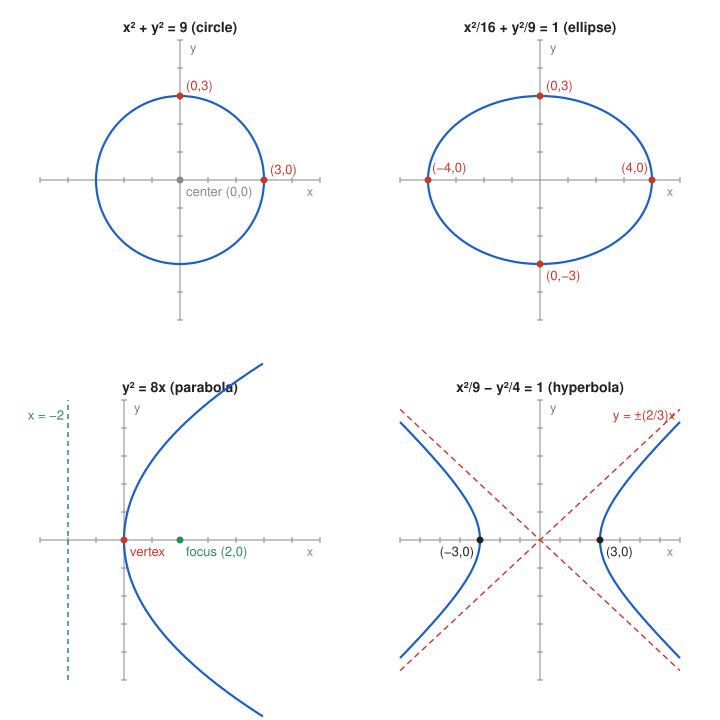

# Exercise 1 — Recognizing Curves from Canonical Form

## The Problem

Recognize the curves

$$
x^2+y^2=9,
$$

$$
\frac{x^2}{16}+\frac{y^2}{9}=1,
$$

$$
y^2=8x,
$$

$$
\frac{x^2}{9}-\frac{y^2}{4}=1.
$$

For each one, identify the most important features and make a sketch. Explain which parts of the equation let you recognize the type of curve.

---

## What Are We Looking For?

For four equations already in canonical form, we want the name of each curve, its key features (center, semiaxes, vertex, focus, asymptotes), a sketch, and the features of the equation that reveal the type.

---

## Idea and Theorem Before the Calculation

**Canonical forms of second-degree curves:**

| Equation | Curve | Recognized by |
|----------|-------|---------------|
| $x^2+y^2=r^2$ | circle, radius $r$ | both squares, plus sign, equal coefficients |
| $\frac{x^2}{a^2}+\frac{y^2}{b^2}=1$ | ellipse, semiaxes $a,b$ | both squares, plus sign, different denominators |
| $y^2=2px$ | parabola, vertex at the origin | only one variable squared |
| $\frac{x^2}{a^2}-\frac{y^2}{b^2}=1$ | hyperbola, asymptotes $y=\pm\frac bax$ | both squares, minus sign |

For the parabola $y^2=2px$ the focus is $\left(\frac p2,0\right)$ and the directrix is $x=-\frac p2$. For the ellipse with $a>b$ the foci are $(\pm c,0)$ with $c^2=a^2-b^2$; for the hyperbola they are $(\pm c,0)$ with $c^2=a^2+b^2$.

---

## Step-by-Step Solution

**Curve 1: $x^2+y^2=9$.**

Both variables are squared with the same coefficient and a plus sign, so this is a **circle**. Center $(0,0)$, radius $r=\sqrt9=3$. It passes through $(\pm3,0)$ and $(0,\pm3)$.

**Curve 2: $\frac{x^2}{16}+\frac{y^2}{9}=1$.**

Both squares appear with a plus sign and different denominators, so this is an **ellipse**. Center $(0,0)$, semiaxes $a=4$ along $x$ and $b=3$ along $y$, vertices $(\pm4,0)$ and $(0,\pm3)$. Since $c^2=16-9=7$, the foci are $(\pm\sqrt7,0)$.

**Curve 3: $y^2=8x$.**

Only $y$ is squared, $x$ appears linearly, so this is a **parabola**. Comparing with $y^2=2px$ gives $p=4$. Vertex $(0,0)$, axis of symmetry the $x$-axis, opening to the right (since $x=\frac{y^2}{8}\ge0$), focus $(2,0)$, directrix $x=-2$.

**Curve 4: $\frac{x^2}{9}-\frac{y^2}{4}=1$.**

Both squares appear with a minus sign between them, so this is a **hyperbola**. Center $(0,0)$, $a=3$, $b=2$, vertices $(\pm3,0)$, asymptotes

$$
y=\pm\frac23x.
$$

Since $c^2=9+4=13$, the foci are $(\pm\sqrt{13},0)$. The branches open left and right, because the positive term contains $x$.

*Why this is valid:* Each equation matches one canonical form exactly, and the features are read off from the constants in that form.

**Sketch.**

---

## Final Answer in Words

1. $x^2+y^2=9$ is a circle with center $(0,0)$ and radius $3$.
2. $\frac{x^2}{16}+\frac{y^2}{9}=1$ is an ellipse with semiaxes $4$ (along $x$) and $3$ (along $y$).
3. $y^2=8x$ is a parabola with vertex $(0,0)$, opening to the right, focus $(2,0)$, directrix $x=-2$.
4. $\frac{x^2}{9}-\frac{y^2}{4}=1$ is a hyperbola with vertices $(\pm3,0)$ and asymptotes $y=\pm\frac23x$.

The type is recognized from which variables are squared and from the sign between the squares.

---

## Quick Verification

Substitute one marked point into each equation:

$$
\begin{aligned}
(0,3):&\quad 0+9=9, \\
(4,0):&\quad \frac{16}{16}+0=1, \\
(2,4):&\quad 4^2=16=8\cdot2, \\
(3,0):&\quad \frac99-0=1.
\end{aligned}
$$

Each point satisfies its equation, which confirms the features used in the sketches.

---

## Common Mistakes

- **Reading the semiaxis as the denominator:** in $\frac{x^2}{16}$ the semiaxis is $\sqrt{16}=4$, not $16$.
- **Confusing ellipse and hyperbola:** the only difference in the equations is the sign between the squares.
- **Letting the parabola open in the wrong direction:** in $y^2=8x$ the variable $x$ cannot be negative, so the parabola opens to the right.

---

## Oral Explanation (3 sentences)

The type of a second-degree curve in canonical form is read from the squares: two squares with a plus sign give a circle or an ellipse, two squares with a minus sign give a hyperbola, and only one square gives a parabola. Here $x^2+y^2=9$ is a circle of radius $3$, the second equation is an ellipse with semiaxes $4$ and $3$, $y^2=8x$ is a parabola opening to the right with focus $(2,0)$, and the last equation is a hyperbola with vertices $(\pm3,0)$ and asymptotes $y=\pm\frac23x$. The constants in the denominators give the scale of each curve, which is what the sketches show.
