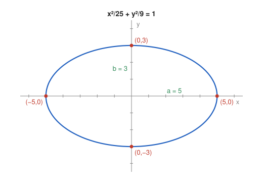

# Exercise 3 — Ellipse

## The Problem

For

$$
\frac{x^2}{25}+\frac{y^2}{9}=1,
$$

find the semiaxis lengths, the intercepts with the coordinate axes, and make a sketch. Explain along which axis the ellipse is more stretched and how this is visible in the equation.

---

## What Are We Looking For?

We want the size and orientation of the ellipse: its two semiaxes, its intercepts with the axes, and the direction in which it is longer.

---

## Idea and Theorem Before the Calculation

**Canonical ellipse:** $\frac{x^2}{a^2}+\frac{y^2}{b^2}=1$ has center $(0,0)$, semiaxis $a$ along the $x$-axis and $b$ along the $y$-axis. It meets the $x$-axis at $(\pm a,0)$ and the $y$-axis at $(0,\pm b)$. The larger of $a$ and $b$ determines the direction of stretching.

---

## Step-by-Step Solution

**Step 1: Semiaxes.**

$$
a^2=25\Rightarrow a=5,\qquad b^2=9\Rightarrow b=3.
$$

**Step 2: Intercepts with the $x$-axis.**

Set $y=0$:

$$
\frac{x^2}{25}=1\quad\Longrightarrow\quad x=\pm5.
$$

The intercepts are $(5,0)$ and $(-5,0)$.

**Step 3: Intercepts with the $y$-axis.**

Set $x=0$:

$$
\frac{y^2}{9}=1\quad\Longrightarrow\quad y=\pm3.
$$

The intercepts are $(0,3)$ and $(0,-3)$.

**Step 4: Direction of stretching.**

Since $a=5>b=3$, the ellipse is more stretched along the **$x$-axis**. In the equation this is visible from the denominators: the larger denominator, $25$, stands under $x^2$. A larger denominator lets the variable reach larger values before the term reaches $1$.

*Why this is valid:* Every point of the ellipse satisfies $\frac{x^2}{25}\le1$ and $\frac{y^2}{9}\le1$, so $|x|\le5$ and $|y|\le3$; the bounds are attained at the intercepts.

**Sketch.**

---

## Final Answer in Words

The semiaxes are $a=5$ (along $x$) and $b=3$ (along $y$). The ellipse meets the $x$-axis at $(\pm5,0)$ and the $y$-axis at $(0,\pm3)$. It is more stretched along the $x$-axis, which is visible from the larger denominator $25$ under $x^2$.

---

## Quick Verification

A point between the intercepts must also satisfy the equation. Take $x=3$:

$$
\frac{9}{25}+\frac{y^2}{9}=1\quad\Longrightarrow\quad y^2=9\cdot\frac{16}{25}\quad\Longrightarrow\quad y=\pm\frac{12}{5}.
$$

The point $\left(3,\frac{12}{5}\right)$ has $|y|<3$, consistent with the sketch, and it gives

$$
\frac{9}{25}+\frac{144}{225}=\frac{81+144}{225}=1.
$$

---

## Common Mistakes

- **Using $25$ and $9$ as the semiaxes:** the semiaxes are the square roots, $5$ and $3$.
- **Assuming the ellipse is stretched along $y$ because $y$ comes second:** what matters is which denominator is larger.
- **Forgetting the negative intercepts:** the ellipse is symmetric, so each intercept appears with both signs.

---

## Oral Explanation (3 sentences)

The denominators $25$ and $9$ are the squares of the semiaxes, so the ellipse has semiaxis $5$ along the $x$-axis and $3$ along the $y$-axis. Setting $y=0$ or $x=0$ gives the intercepts $(\pm5,0)$ and $(0,\pm3)$. The ellipse is longer in the $x$-direction, because the larger denominator stands under $x^2$.
