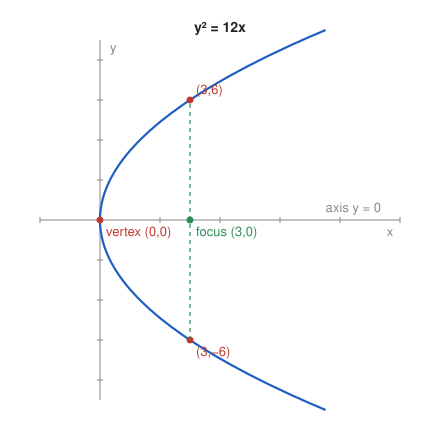

# Exercise 4 — Parabola

## The Problem

For

$$
y^2=12x,
$$

identify the vertex, axis of symmetry, and opening direction. Find points on the parabola for $x=3$ and use them to make a sketch.

---

## What Are We Looking For?

We want the basic geometry of the parabola: where it starts, which line it is symmetric about, which way it opens, and a few points to anchor a sketch.

---

## Idea and Theorem Before the Calculation

**Canonical parabola:** $y^2=2px$ with $p>0$ has vertex $(0,0)$, axis of symmetry the $x$-axis, and opens to the right. Its focus is $\left(\frac p2,0\right)$ and its directrix is $x=-\frac p2$.

---

## Step-by-Step Solution

**Step 1: Compare with the canonical form.**

$$
2p=12\quad\Longrightarrow\quad p=6.
$$

**Step 2: Vertex.**

Setting $y=0$ gives $x=0$, so the vertex is $(0,0)$.

**Step 3: Axis of symmetry.**

Replacing $y$ by $-y$ does not change the equation, so the parabola is symmetric about the $x$-axis, the line $y=0$.

**Step 4: Opening direction.**

$$
x=\frac{y^2}{12}\ge0.
$$

All points have $x\ge0$, and $x$ grows as $|y|$ grows, so the parabola opens **to the right**.

**Step 5: Points for $x=3$.**

$$
y^2=12\cdot3=36\quad\Longrightarrow\quad y=\pm6.
$$

The points are $(3,6)$ and $(3,-6)$. They are symmetric about the axis, as expected. Since the focus is $\left(\frac p2,0\right)=(3,0)$, these two points lie exactly above and below the focus.

*Why this is valid:* For each $x>0$ the equation has two solutions $y=\pm\sqrt{12x}$, which are mirror images in the $x$-axis.

**Sketch.**

---

## Final Answer in Words

The parabola $y^2=12x$ has vertex $(0,0)$, axis of symmetry the $x$-axis, and opens to the right. For $x=3$ it passes through $(3,6)$ and $(3,-6)$; these points lie directly above and below the focus $(3,0)$.

---

## Quick Verification

$$
6^2=36=12\cdot3,\qquad (-6)^2=36=12\cdot3.
$$

Both points satisfy the equation. For one more point, $x=\frac{12}{12}=1$ gives $y=\pm\sqrt{12}\approx\pm3.46$, which lies between the vertex and the points for $x=3$, consistent with the sketch.

---

## Common Mistakes

- **Taking the $y$-axis as the axis of symmetry:** the squared variable is $y$, so the symmetry is $y\leftrightarrow-y$, about the $x$-axis.
- **Giving only $(3,6)$:** both signs of the square root give points of the parabola.
- **Opening to the left:** with $12>0$ the variable $x$ must be nonnegative, so the parabola opens to the right.

---

## Oral Explanation (3 sentences)

In $y^2=12x$ only $y$ is squared, so the parabola is symmetric about the $x$-axis and has its vertex at the origin. Since $x=\frac{y^2}{12}$ is never negative, the parabola opens to the right. Substituting $x=3$ gives $y=\pm6$, so the parabola passes through $(3,6)$ and $(3,-6)$, which lie directly above and below its focus $(3,0)$.
