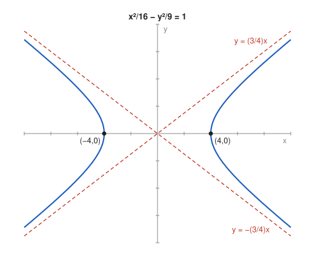

# Exercise 5 — Hyperbola and Asymptotes

## The Problem

For

$$
\frac{x^2}{16}-\frac{y^2}{9}=1,
$$

find the intercepts with the $x$-axis, the asymptotes, and make a sketch. Explain why the asymptotes describe the behavior of the curve far from the center.

---

## What Are We Looking For?

We want the vertices of the hyperbola on the $x$-axis, the two lines it approaches, and an argument showing that the curve really gets arbitrarily close to these lines.

---

## Idea and Theorem Before the Calculation

**Canonical hyperbola:** $\frac{x^2}{a^2}-\frac{y^2}{b^2}=1$ has center $(0,0)$, vertices $(\pm a,0)$, no intersection with the $y$-axis, and asymptotes

$$
y=\pm\frac bax.
$$

---

## Step-by-Step Solution

**Step 1: Parameters.**

$$
a^2=16\Rightarrow a=4,\qquad b^2=9\Rightarrow b=3.
$$

**Step 2: Intercepts with the $x$-axis.**

Set $y=0$:

$$
\frac{x^2}{16}=1\quad\Longrightarrow\quad x=\pm4.
$$

The intercepts are $(4,0)$ and $(-4,0)$. There are no intercepts with the $y$-axis, because $x=0$ would give $-\frac{y^2}{9}=1$, which has no real solution.

**Step 3: Asymptotes.**

$$
y=\frac34x\qquad\mathrm{and}\qquad y=-\frac34x.
$$

**Step 4: Why the curve approaches the asymptotes.**

Solving the equation for $y$ in the first quadrant gives

$$
y=\frac34\sqrt{x^2-16},\qquad x\ge4.
$$

The vertical gap between the asymptote and the curve is

$$
\frac34x-\frac34\sqrt{x^2-16}=\frac34\cdot\frac{x^2-(x^2-16)}{x+\sqrt{x^2-16}}=\frac{12}{x+\sqrt{x^2-16}}.
$$

As $x$ grows, the denominator grows without bound, so the gap tends to $0$. The curve stays below the asymptote but comes arbitrarily close to it. By symmetry the same happens in the other three quadrants.

*Why this is valid:* For large $|x|$, the constant $16$ is negligible compared with $x^2$, so $\sqrt{x^2-16}\approx|x|$ and the curve behaves like the lines $y=\pm\frac34x$.

**Sketch.**

---

## Final Answer in Words

The hyperbola meets the $x$-axis at $(\pm4,0)$ and does not meet the $y$-axis. Its asymptotes are $y=\pm\frac34x$. Far from the center the curve approaches these lines, because the gap between them equals $\frac{12}{x+\sqrt{x^2-16}}$, which tends to zero as $x$ grows.

---

## Quick Verification

Take $x=5$: the curve gives $y=\frac34\sqrt{25-16}=\frac94$, and the asymptote gives $\frac{15}{4}$. The gap is $\frac64=1.5$, and the formula gives $\frac{12}{5+3}=1.5$.

Take $x=20$: the gap is $\frac{12}{20+\sqrt{384}}\approx\frac{12}{39.6}\approx0.30$, much smaller. The point $\left(5,\frac94\right)$ satisfies the equation: $\frac{25}{16}-\frac{81}{144}=\frac{225-81}{144}=1$.

---

## Common Mistakes

- **Writing the asymptotes as $y=\pm\frac43x$:** the slope is $\frac ba$, the $y$-parameter over the $x$-parameter.
- **Looking for intercepts with the $y$-axis:** for this hyperbola there are none.
- **Thinking the curve crosses the asymptotes:** the curve approaches them from one side and never meets them.

---

## Oral Explanation (3 sentences)

Setting $y=0$ gives the vertices $(\pm4,0)$, and the asymptotes of $\frac{x^2}{16}-\frac{y^2}{9}=1$ are the lines $y=\pm\frac34x$. Far from the center the constant $1$ in the equation becomes negligible compared with the squared terms, so the curve behaves like $\frac{x^2}{16}=\frac{y^2}{9}$, which is exactly the pair of asymptotes. Precisely, the gap between the curve and the asymptote equals $\frac{12}{x+\sqrt{x^2-16}}$, which tends to zero as $x$ grows.
