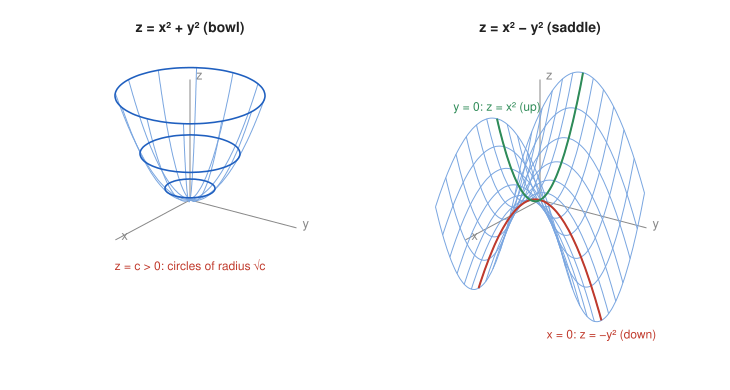

# Exercise 10 — Paraboloids

## The Problem

Compare

$$
z=x^2+y^2
$$

and

$$
z=x^2-y^2.
$$

For each surface, describe the cross-sections $x=0$, $y=0$, and $z=c$, then make a qualitative sketch.

---

## What Are We Looking For?

We want to see how a single change of sign turns one surface into a completely different one, by comparing the curves obtained in vertical and horizontal slices.

---

## Idea and Theorem Before the Calculation

**Cross-sections:** fixing one variable in a surface equation gives a curve in the plane of the other two variables.

- Vertical slices $x=0$ and $y=0$ show the profile of the surface.
- Horizontal slices $z=c$ show its level curves.

---

## Step-by-Step Solution

**Surface 1: $z=x^2+y^2$.**

- $x=0$: $z=y^2$, a parabola opening upward.
- $y=0$: $z=x^2$, a parabola opening upward.
- $z=c$: $x^2+y^2=c$.
  - $c>0$: a circle with radius $\sqrt c$;
  - $c=0$: the single point $(0,0,0)$;
  - $c<0$: no points.

Both profiles open upward and the level curves are circles growing with height, so the surface is a **bowl**, a circular paraboloid with its lowest point at the origin.

**Surface 2: $z=x^2-y^2$.**

- $x=0$: $z=-y^2$, a parabola opening **downward**.
- $y=0$: $z=x^2$, a parabola opening **upward**.
- $z=c$: $x^2-y^2=c$.
  - $c>0$: a hyperbola with branches opening along the $x$-axis;
  - $c=0$: the two lines $y=\pm x$;
  - $c<0$: a hyperbola with branches opening along the $y$-axis.

The profile goes up in the $x$-direction and down in the $y$-direction, and the level curves are hyperbolas, so the surface is a **saddle**, a hyperbolic paraboloid. The origin is a minimum along the $x$-axis and a maximum along the $y$-axis.

*Why this is valid:* Each slice is obtained by substituting the fixed value into the equation and recognizing the resulting plane curve.

**Comparison.**

| Slice | $z=x^2+y^2$ | $z=x^2-y^2$ |
|-------|-------------|-------------|
| $x=0$ | $z=y^2$, up | $z=-y^2$, down |
| $y=0$ | $z=x^2$, up | $z=x^2$, up |
| $z=c>0$ | circle, radius $\sqrt c$ | hyperbola along $x$ |
| $z=0$ | point | lines $y=\pm x$ |
| $z=c<0$ | empty | hyperbola along $y$ |

**Sketch.**

---

## Final Answer in Words

$z=x^2+y^2$ is a bowl: both vertical profiles are upward parabolas, and the horizontal slices are circles of radius $\sqrt c$ for $c>0$, a point for $c=0$, and empty for $c<0$. $z=x^2-y^2$ is a saddle: the profile is an upward parabola along $x$ and a downward parabola along $y$, and the horizontal slices are hyperbolas, degenerating into the two lines $y=\pm x$ at $z=0$.

---

## Quick Verification

The point $(1,1,2)$ lies on the bowl ($1+1=2$) on the circle $z=2$ of radius $\sqrt2$: indeed $\sqrt{1+1}=\sqrt2$.

The points $(1,0,1)$ and $(0,1,-1)$ lie on the saddle: $1-0=1$ and $0-1=-1$. They are on opposite sides of the level $z=0$, one above along the $x$-axis and one below along the $y$-axis, which is exactly the saddle shape.

---

## Common Mistakes

- **Expecting circles for the saddle:** the minus sign turns the level curves into hyperbolas.
- **Calling the slice $z=0$ of the saddle a point:** it is the pair of lines $y=\pm x$.
- **Overlooking empty slices:** the bowl has no points below $z=0$.

---

## Oral Explanation (3 sentences)

For $z=x^2+y^2$ both vertical slices are upward parabolas and the horizontal slices are circles of radius $\sqrt c$, so the surface is a bowl with its lowest point at the origin. For $z=x^2-y^2$ the slice $y=0$ is an upward parabola but the slice $x=0$ is a downward one, and the horizontal slices are hyperbolas that turn into the lines $y=\pm x$ at height zero. This combination of rising in one direction and falling in the other is the shape of a saddle.
