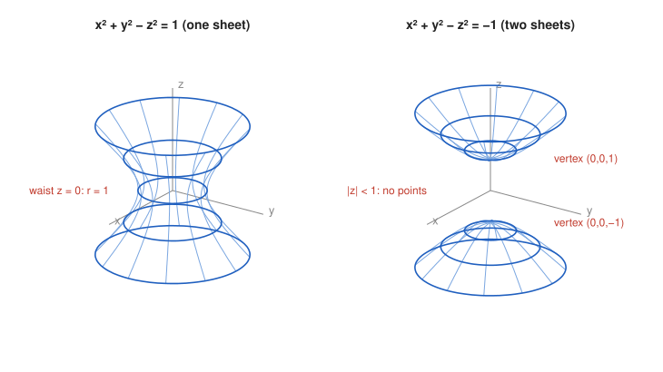

# Exercise 11 — Two Similar Surfaces

## The Problem

Compare

$$
x^2+y^2-z^2=1
$$

and

$$
x^2+y^2-z^2=-1.
$$

For several values $z=c$, check whether the cross-section exists and what its radius is. Based on this, describe qualitatively the difference between the surfaces and make sketches.

---

## What Are We Looking For?

The two equations differ only in the sign of the right side. We want to see, slice by slice, how this changes the shape of the surface.

---

## Idea and Theorem Before the Calculation

**Horizontal slices of a surface of revolution:** Substituting $z=c$ gives an equation $x^2+y^2=R$. It describes

- a circle of radius $\sqrt R$ if $R>0$,
- the point $(0,0,c)$ if $R=0$,
- no points if $R<0$.

---

## Step-by-Step Solution

**Step 1: Slices of the first surface.**

$$
x^2+y^2=1+c^2.
$$

Since $1+c^2\ge1>0$ for every $c$, every slice exists and is a circle of radius $\sqrt{1+c^2}$.

**Step 2: Slices of the second surface.**

$$
x^2+y^2=c^2-1.
$$

This is positive only for $|c|>1$, zero for $|c|=1$, and negative for $|c|<1$.

**Step 3: Table of slices.**

| $c$ | first surface: radius | second surface: radius |
|-----|-----------------------|------------------------|
| $0$ | $1$ | no points |
| $\pm\frac12$ | $\sqrt{\frac54}\approx1.12$ | no points |
| $\pm1$ | $\sqrt2\approx1.41$ | $0$ (single point) |
| $\pm2$ | $\sqrt5\approx2.24$ | $\sqrt3\approx1.73$ |
| $\pm3$ | $\sqrt{10}\approx3.16$ | $\sqrt8\approx2.83$ |

**Step 4: Qualitative description.**

*First surface.* Every horizontal plane cuts it in a circle. The smallest circle, of radius $1$, is at $z=0$, and the radius grows as $|c|$ grows. The surface is one connected piece shaped like a cooling tower: a **hyperboloid of one sheet**.

*Second surface.* There is a gap $-1<z<1$ with no points at all. At $z=\pm1$ the surface has the single points $(0,0,\pm1)$, and beyond them circles open up and grow. The surface consists of two separate bowl-shaped pieces: a **hyperboloid of two sheets**.

*Why this is valid:* The vertical slice $x=0$ confirms the picture: the first surface gives $y^2-z^2=1$, a hyperbola opening sideways, which rotated about the $z$-axis gives one connected surface; the second gives $z^2-y^2=1$, a hyperbola opening up and down, whose two branches rotate into two separate pieces.

For large $|c|$ the radii of both surfaces approach $|c|$, so both surfaces approach the cone $x^2+y^2=z^2$, one from outside and one from inside.

**Sketches.**

---

## Final Answer in Words

For $x^2+y^2-z^2=1$ every slice $z=c$ is a circle of radius $\sqrt{1+c^2}$, smallest ($1$) at $z=0$, so the surface is one connected piece narrowing at the middle: a hyperboloid of one sheet. For $x^2+y^2-z^2=-1$ the slices exist only for $|c|\ge1$, with radius $\sqrt{c^2-1}$, so there is no surface between $z=-1$ and $z=1$ and the surface consists of two separate pieces: a hyperboloid of two sheets.

---

## Quick Verification

Points from the table:

$$
\begin{aligned}
(1,0,0)&:\quad 1+0-0=1, \\
(\sqrt5,0,2)&:\quad 5+0-4=1, \\
(0,0,1)&:\quad 0+0-1=-1, \\
(\sqrt3,0,2)&:\quad 3+0-4=-1.
\end{aligned}
$$

The first two satisfy the first equation and the last two the second. For the second surface at $z=0$ the equation would require $x^2+y^2=-1$, which is impossible.

---

## Common Mistakes

- **Assuming both surfaces have the same pieces:** the sign of the right side decides whether the surface is connected.
- **Taking the radius as $1+c^2$:** the radius is the square root, $\sqrt{1+c^2}$.
- **Forgetting the single points at $z=\pm1$:** these are the vertices of the two sheets.

---

## Oral Explanation (3 sentences)

For $x^2+y^2-z^2=1$ every horizontal slice is a circle of radius $\sqrt{1+c^2}$, so the surface is one connected tube that is narrowest, with radius $1$, at $z=0$. For $x^2+y^2-z^2=-1$ the slices have radius $\sqrt{c^2-1}$, which exists only when $|c|\ge1$, so there are no points between $z=-1$ and $z=1$. Therefore the first surface is a hyperboloid of one sheet and the second is a hyperboloid of two sheets, made of two separate bowls starting at $(0,0,\pm1)$.
