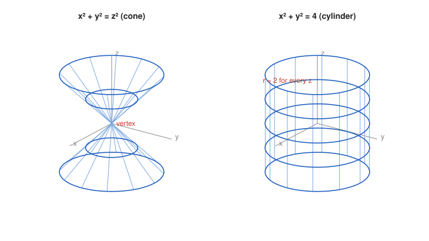

# Exercise 14 — Cone and Cylinder

## The Problem

Compare

$$
x^2+y^2=z^2
$$

and

$$
x^2+y^2=4.
$$

For each surface, describe the cross-sections $z=c$, $x=0$, and $y=0$, make a sketch, and explain why the radius of the cross-section depends on $z$ in the first case but is constant in the second.

---

## What Are We Looking For?

We want to distinguish a cone from a cylinder by comparing their horizontal and vertical slices.

---

## Idea and Theorem Before the Calculation

**Slices:** fixing one variable gives a plane curve. For surfaces of the form $x^2+y^2=R(z)$, the horizontal slices are circles centered on the $z$-axis with radius $\sqrt{R(z)}$.

---

## Step-by-Step Solution

**Surface 1: $x^2+y^2=z^2$.**

- $z=c$: $x^2+y^2=c^2$, a circle of radius $|c|$ for $c\neq0$ and the single point $(0,0,0)$ for $c=0$.
- $x=0$: $y^2=z^2$, that is $y=\pm z$, two lines crossing at the origin.
- $y=0$: $x^2=z^2$, that is $x=\pm z$, two lines crossing at the origin.

The circles grow linearly with $|z|$, and the profiles are straight lines through the origin: this is a double **cone** with vertex at the origin.

**Surface 2: $x^2+y^2=4$.**

- $z=c$: $x^2+y^2=4$, a circle of radius $2$ for **every** $c$.
- $x=0$: $y^2=4$, that is $y=\pm2$, two parallel vertical lines.
- $y=0$: $x^2=4$, that is $x=\pm2$, two parallel vertical lines.

All horizontal slices are the same circle, and the profiles are vertical lines: this is a **cylinder** of radius $2$ around the $z$-axis.

**Why the radius depends on $z$ only for the cone.**

In the cone equation the right side is $z^2$, so the radius of the slice at height $c$ is $\sqrt{c^2}=|c|$, which changes with the height. In the cylinder equation the variable $z$ does not appear at all, so the equation puts no condition on $z$. Every height gives the same condition $x^2+y^2=4$, and therefore the same circle.

*Why this is valid:* The radius of a horizontal slice is read directly from the right side of $x^2+y^2=R$; it varies with $z$ exactly when $R$ depends on $z$.

**Sketch.**

---

## Final Answer in Words

The cone $x^2+y^2=z^2$ has horizontal slices that are circles of radius $|c|$ (a point at $c=0$) and vertical slices $x=0$, $y=0$ that are pairs of crossing lines $y=\pm z$, $x=\pm z$. The cylinder $x^2+y^2=4$ has the same circle of radius $2$ at every height and vertical slices that are pairs of parallel lines $y=\pm2$, $x=\pm2$. The radius depends on $z$ for the cone because $z$ appears in its equation, while the cylinder's equation does not contain $z$ at all.

---

## Quick Verification

Cone: the points $(3,0,3)$ and $(0,-2,2)$ satisfy $9+0=9$ and $0+4=4$; they lie on slices of radius $3$ and $2$ at heights $3$ and $2$, as predicted.

Cylinder: the points $(2,0,-5)$ and $(0,2,100)$ both satisfy $x^2+y^2=4$, although their heights differ enormously, which shows that the height is unrestricted.

---

## Common Mistakes

- **Writing the cone slice radius as $c$:** for negative $c$ the radius is $|c|$.
- **Thinking $x^2+y^2=4$ is a circle:** in space, an equation without $z$ describes a cylinder; a circle needs the extra condition $z=c$.
- **Describing the cone's vertical slices as parabolas:** they are straight lines, which is what makes it a cone.

---

## Oral Explanation (3 sentences)

The cone $x^2+y^2=z^2$ has horizontal slices that are circles of radius $|c|$, shrinking to a point at the origin, and its vertical slices through the axis are pairs of crossing lines $y=\pm z$ and $x=\pm z$. The cylinder $x^2+y^2=4$ has the same circle of radius $2$ at every height and vertical slices that are pairs of parallel lines $y=\pm2$ and $x=\pm2$. The difference comes from the equations: the cone's right side $z^2$ makes the radius depend on the height, while the cylinder's equation does not contain $z$ at all.
