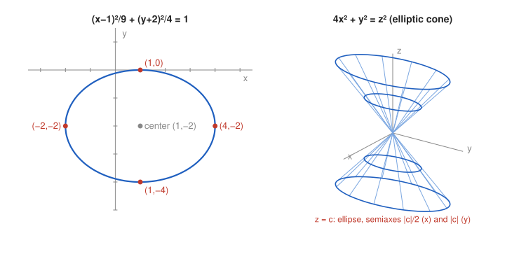

# Exercise 15 — Recognition and Sketch Without a Given Name

## The Problem

Consider the two equations:

$$
4x^2+9y^2-8x+36y+4=0,
$$

$$
4x^2+y^2=z^2.
$$

For the first equation, reduce it to canonical form, recognize the curve, give its most important features, and make a sketch.

For the second equation, do not begin by using a ready-made name for the surface. First describe the cross-sections $z=c$ and the cross-sections by the planes $x=0$ and $y=0$, paying attention to the different scales along the axes. Only then identify the surface and make a sketch.

---

## What Are We Looking For?

For the curve, we want the canonical form and its features. For the surface, we want to build its shape from cross-sections first and name it only at the end.

---

## Idea and Theorem Before the Calculation

**Completing the square with leading coefficients:** factor out the coefficient of each square before completing it (see Exercise 6).

**Recognition through cross-sections:** horizontal slices $z=c$ show the level curves, and vertical slices $x=0$, $y=0$ show the profiles; together they determine the shape.

---

## Step-by-Step Solution

### Part 1: The curve $4x^2+9y^2-8x+36y+4=0$

**Step 1: Group and factor.**

$$
4(x^2-2x)+9(y^2+4y)=-4.
$$

**Step 2: Complete the squares.**

$$
4\left[(x-1)^2-1\right]+9\left[(y+2)^2-4\right]=-4.
$$

**Step 3: Simplify.**

$$
4(x-1)^2-4+9(y+2)^2-36=-4\quad\Longrightarrow\quad 4(x-1)^2+9(y+2)^2=36.
$$

**Step 4: Canonical form.**

$$
\frac{(x-1)^2}{9}+\frac{(y+2)^2}{4}=1.
$$

**Step 5: Features.**

This is an **ellipse** with center $(1,-2)$, horizontal semiaxis $3$ and vertical semiaxis $2$. Its vertices are

$$
(4,-2),\quad(-2,-2),\quad(1,0),\quad(1,-4).
$$

Since $c^2=9-4=5$, the foci are $(1\pm\sqrt5,\ -2)$.

### Part 2: The surface $4x^2+y^2=z^2$

**Step 6: Horizontal slices $z=c$.**

$$
4x^2+y^2=c^2.
$$

- $c=0$: $4x^2+y^2=0$, so $x=y=0$, the single point $(0,0,0)$.
- $c\neq0$: dividing by $c^2$,

$$
\frac{x^2}{(c/2)^2}+\frac{y^2}{c^2}=1,
$$

an ellipse with semiaxis $\frac{|c|}{2}$ along $x$ and $|c|$ along $y$. The ellipses grow linearly with $|c|$ and always have the same $1:2$ shape, twice as long in the $y$-direction as in the $x$-direction.

**Step 7: Vertical slice $x=0$.**

$$
y^2=z^2\quad\Longrightarrow\quad y=\pm z,
$$

two lines through the origin with slope $1$.

**Step 8: Vertical slice $y=0$.**

$$
4x^2=z^2\quad\Longrightarrow\quad z=\pm2x,
$$

two lines through the origin with slope $2$, steeper than in the plane $x=0$. This is the different scale along the axes: to reach height $z$ one moves only $\frac{|z|}{2}$ in the $x$-direction but $|z|$ in the $y$-direction.

**Step 9: Identify the surface.**

Every horizontal slice is an ellipse of fixed shape whose size is proportional to $|z|$, the slice at $z=0$ is a point, and the vertical profiles are straight lines through that point. A surface made of straight lines through one point with elliptical cross-sections is an **elliptic cone** with vertex at the origin and axis along the $z$-axis, narrower in the $x$-direction than in the $y$-direction.

*Why this is valid:* If $(x,y,z)$ lies on the surface, so does $(tx,ty,tz)$ for every $t$, because both sides of the equation are multiplied by $t^2$; hence the surface is made of lines through the origin, which is exactly what a cone is.

**Sketch.**

---

## Final Answer in Words

The first equation is the ellipse $\frac{(x-1)^2}{9}+\frac{(y+2)^2}{4}=1$ with center $(1,-2)$, semiaxes $3$ (horizontal) and $2$ (vertical), and vertices $(4,-2)$, $(-2,-2)$, $(1,0)$, $(1,-4)$. The second surface has horizontal slices that are ellipses with semiaxes $\frac{|c|}{2}$ and $|c|$, shrinking to a point at $z=0$, and vertical slices that are the line pairs $y=\pm z$ and $z=\pm2x$; it is an elliptic cone with vertex at the origin, narrower along the $x$-axis.

---

## Quick Verification

Ellipse: the vertex $(4,-2)$ satisfies the original equation:

$$
4\cdot16+9\cdot4-8\cdot4+36\cdot(-2)+4=64+36-32-72+4=0.
$$

Cone: the point $(1,0,2)$ lies on the line $z=2x$ and on the surface, since $4+0=4$; the point $(0,2,2)$ lies on the line $y=z$ and on the surface, since $0+4=4$. At the same height $z=2$, the surface reaches $x=1$ but $y=2$, confirming the $1:2$ ratio of the semiaxes.

---

## Common Mistakes

- **Forgetting to multiply the subtracted constants by $4$ and $9$:** completing $x^2-2x$ inside $4(\ldots)$ subtracts $4\cdot1$, not $1$.
- **Calling the cone circular:** the coefficient $4$ in front of $x^2$ makes the slices ellipses, not circles.
- **Mixing up the slopes:** in the plane $y=0$ the profile is $z=\pm2x$, so the cone is steeper there, not flatter.

---

## Oral Explanation (3 sentences)

Completing the squares turns the first equation into $\frac{(x-1)^2}{9}+\frac{(y+2)^2}{4}=1$, an ellipse with center $(1,-2)$ and semiaxes $3$ and $2$. For the second equation, the horizontal slices are ellipses with semiaxes $\frac{|c|}{2}$ and $|c|$ that shrink to a point at $z=0$, while the vertical slices are pairs of lines, $y=\pm z$ and $z=\pm2x$. A surface made of straight lines through one point with elliptical slices is an elliptic cone, here twice as narrow in the $x$-direction as in the $y$-direction.
