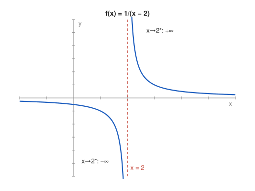

# Exercise 9 — One-Sided Limits and an Asymptote

## The Problem

Analyze the left-hand and right-hand limits of

$$
f(x)=\frac1{x-2}
$$

as $x\to2$. Does the two-sided limit exist? Interpret the result on a sketch of the graph and identify the vertical asymptote.

---

## What Are We Looking For?

We want the behavior of $f$ when $x$ approaches $2$ from the left and from the right, a decision about the two-sided limit, and the geometric meaning of the result.

---

## Idea and Theorem Before the Calculation

**One-sided limits:** $\lim_{x\to2^-}f(x)$ uses only $x<2$, and $\lim_{x\to2^+}f(x)$ uses only $x>2$.

**Two-sided limit:** $\lim_{x\to2}f(x)$ exists if and only if both one-sided limits exist and are equal.

**Sign of a small denominator:** If the numerator stays near a nonzero number and the denominator tends to $0$, the fraction grows without bound; its sign is the sign of the quotient.

**Vertical asymptote:** The line $x=a$ is a vertical asymptote if at least one one-sided limit at $a$ is $+\infty$ or $-\infty$.

---

## Step-by-Step Solution

**Step 1: Domain.** $f$ is defined for $x\neq2$.

**Step 2: Left-hand limit.**

For $x<2$, the denominator $x-2$ is negative and tends to $0$. Hence

$$
\lim_{x\to2^-}\frac{1}{x-2}=-\infty.
$$

For example, $f(1.99)=\frac{1}{-0.01}=-100$.

**Step 3: Right-hand limit.**

For $x>2$, the denominator is positive and tends to $0$. Hence

$$
\lim_{x\to2^+}\frac{1}{x-2}=+\infty.
$$

For example, $f(2.01)=100$.

**Step 4: Two-sided limit.**

The one-sided limits are different ($-\infty$ and $+\infty$), so the two-sided limit does not exist, not even as an improper limit.

**Step 5: Asymptotes.**

Since the one-sided limits at $2$ are infinite, the line $x=2$ is a vertical asymptote. In addition $\frac{1}{x-2}\to0$ as $x\to\pm\infty$, so $y=0$ is a horizontal asymptote.

---

## Sketch

The graph is the hyperbola $y=\frac1x$ shifted $2$ units to the right. To the left of $x=2$ the branch falls to $-\infty$; to the right it comes down from $+\infty$. Both branches approach the $x$-axis far away.

---

## Final Answer in Words

$$
\lim_{x\to2^-}\frac{1}{x-2}=-\infty,\qquad \lim_{x\to2^+}\frac{1}{x-2}=+\infty.
$$

The two-sided limit does not exist because the one-sided limits differ. The line $x=2$ is a vertical asymptote, and $y=0$ is a horizontal asymptote.

---

## Quick Verification

A table near $2$:

| $x$ | $1.9$ | $1.99$ | $1.999$ | $2.001$ | $2.01$ | $2.1$ |
|---|---|---|---|---|---|---|
| $f(x)$ | $-10$ | $-100$ | $-1000$ | $1000$ | $100$ | $10$ |

The values grow in size without bound, negative on the left and positive on the right, as computed.

---

## Common Mistakes

- **Writing $\lim_{x\to2}\frac{1}{x-2}=\infty$:** the sign is different on each side, so there is no common limit.
- **Ignoring the sign of the denominator:** "$\frac{1}{0}=\infty$" loses the information about the side.
- **Thinking the function has a value at $2$:** the line $x=2$ is not part of the graph.

---

## Oral Explanation (3 sentences)

When $x$ approaches $2$ from the left, the denominator $x-2$ is a small negative number, so the fraction tends to $-\infty$; from the right it is a small positive number, so the fraction tends to $+\infty$. Because the two one-sided limits are different, the two-sided limit at $2$ does not exist. Geometrically the graph has a vertical asymptote $x=2$, with one branch going down and the other going up along it.
