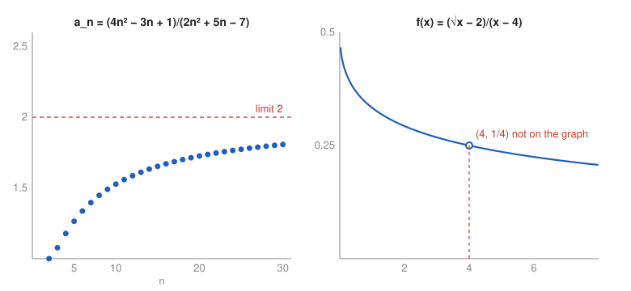

# Exercise 15 — Observation Versus Proof

## The Problem

Choose one sequence and one function from this set. For the sequence, compute several values for increasingly large $n$. For the function, prepare a table of values with arguments approaching the limit point from the left and right. Sketch the behavior of both objects.

Compare the observation with the analytical result and explain why a finite number of calculations or a sketch does not constitute a proof that the limit exists.

---

## What Are We Looking For?

We want numerical evidence for one sequence limit and one function limit from this set, a sketch of both, a comparison with the exact results, and an explanation of why such evidence does not prove a limit.

---

## Idea and Theorem Before the Calculation

**Chosen objects:**

- the sequence from Exercise 1, $a_n=\frac{4n^2-3n+1}{2n^2+5n-7}$, with analytical limit $2$,
- the function from Exercise 8, $f(x)=\frac{\sqrt{x}-2}{x-4}$, with analytical limit $\frac14$ at $x=4$.

**Definition of a limit:** $a_n\to L$ means that for every $\varepsilon>0$ there is $N$ such that $|a_n-L|<\varepsilon$ for all $n>N$. It is a statement about infinitely many terms, so no finite table can verify it.

---

## Step-by-Step Solution

**Step 1: Table for the sequence.**

| $n$ | $10$ | $100$ | $1000$ | $10\,000$ |
|---|---|---|---|---|
| $a_n$ | $1.52675$ | $1.93730$ | $1.99352$ | $1.99935$ |

The terms increase and approach $2$; the distance to $2$ shrinks roughly like $\frac{6.5}{n}$, because $a_n-2=\frac{-13n+15}{2n^2+5n-7}$.

**Step 2: Table for the function.**

| $x$ | $3.9$ | $3.99$ | $3.999$ | $4.001$ | $4.01$ | $4.1$ |
|---|---|---|---|---|---|---|
| $f(x)$ | $0.25158$ | $0.25016$ | $0.25002$ | $0.24998$ | $0.24984$ | $0.24846$ |

From the left the values are slightly above $0.25$, from the right slightly below, and both sides approach $0.25$.

**Step 3: Sketch.**

The sequence points climb towards the dashed line $y=2$. The graph of $f$ is a smooth decreasing curve with a hole at $(4,\frac14)$, because $f(4)$ is undefined.

**Step 4: Comparison with the analytical results.**

Exercise 1 gives $\lim a_n=2$, and Exercise 8 gives $\lim_{x\to4}f(x)=\frac14$. The observations agree with both. They even agree with the finer structure: $a_n<2$ for large $n$ (the difference above is negative), and $f(x)=\frac{1}{\sqrt{x}+2}$ is decreasing, so it is above $\frac14$ for $x<4$ and below it for $x>4$.

---

## Why Observation Is Not Proof

- **Finitely many values:** a limit is a statement about all $n$ beyond some point (or all $x$ in a neighborhood), and a table checks only a few. The sequence $b_n=a_n+\frac{n}{10^{12}}$ has the same table to five decimals for $n\le10^4$, yet $b_n\to+\infty$.
- **Precision:** a table cannot distinguish the limit $0.25$ from $0.25001$; it shows closeness, not equality.
- **Sketches hide behavior:** a function such as $\sin\frac1x$ near $0$ oscillates faster than any drawing can show, and a graph drawn from sample points can look convergent when it is not.
- **Rounding:** computers evaluate $\frac{\sqrt{x}-2}{x-4}$ for $x$ extremely close to $4$ with large relative errors (subtracting nearly equal numbers), so numerical evidence can even become misleading.

The algebraic arguments in Exercises 1 and 8 work for every $n$ and every $x\neq4$ at once, which is what a proof requires.

---

## Final Answer in Words

The numerical values of $a_n$ approach $2$ and the values of $f(x)$ approach $\frac14$ from both sides, in agreement with the exact results of Exercises 1 and 8. However, a table or sketch checks only finitely many points with limited precision, so it can suggest a limit and help detect errors, but only an analytical argument proves that the limit exists.

---

## Quick Verification

The exact formula $f(x)=\frac{1}{\sqrt{x}+2}$ predicts $f(4.01)=\frac{1}{2.0024984+2}\approx0.24984$, which matches the table entry, so the table and the algebra are consistent.

---

## Common Mistakes

- **Using only one side for a function limit:** both one-sided tables are needed, as Exercise 9 shows.
- **Stopping at "the numbers look like 2":** this is a conjecture until an argument is given.
- **Trusting very small $h=x-4$ blindly:** rounding errors grow when nearly equal numbers are subtracted.

---

## Oral Explanation (3 sentences)

The terms of the sequence from Exercise 1 approach $2$, and the values of the function from Exercise 8 approach $\frac14$ from both sides of $x=4$, exactly as the analytical computations predict. Still, a table contains finitely many numbers with limited precision, and there are sequences and functions whose first values look the same but whose limits are different. Observation is useful for forming and checking conjectures, but only an argument valid for all arguments proves a limit.
