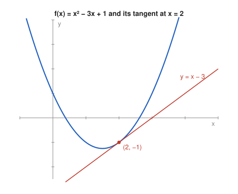

# Problem 10 — The Tangent Line as an Application of the Derivative

## The Problem

For

$$
f(x)=x^2-3x+1
$$

find the equation of the tangent line at the point with $x=2$. Give the point of tangency, the value $f'(2)$, the equation of the line, and verify that the point lies on the obtained tangent line.

---

## What Are We Looking For?

We want the line that touches the parabola at $x=2$: its point of tangency, its slope, and its equation.

---

## Idea and Theorem Before the Calculation

**Tangent line formula:** The tangent to the graph of $f$ at $x_0$ is

$$
y=f(x_0)+f'(x_0)(x-x_0).
$$

It passes through $(x_0,f(x_0))$ and has slope $f'(x_0)$.

---

## Step-by-Step Solution

**Step 1: Point of tangency.**

$$
f(2)=4-6+1=-1,
$$

so the point is $(2,-1)$.

**Step 2: Slope.**

$$
f'(x)=2x-3,\qquad f'(2)=1.
$$

**Step 3: Equation.**

$$
y=-1+1\cdot(x-2)=x-3.
$$

**Step 4: Verify the point.**

Substituting $x=2$ into $y=x-3$ gives $y=-1$, which is $f(2)$. The point $(2,-1)$ lies on the tangent.

---

## Sketch

---

## Final Answer in Words

The point of tangency is $(2,-1)$, the slope is $f'(2)=1$, and the tangent line is

$$
y=x-3.
$$

---

## Quick Verification

The tangent should touch the parabola only at $x=2$. Subtracting:

$$
f(x)-(x-3)=x^2-4x+4=(x-2)^2\ge0.
$$

The difference is zero only at $x=2$ (a double root), and the parabola lies above the tangent everywhere else, exactly as expected for a tangent to an upward-opening parabola.

---

## Common Mistakes

- **Using $f'(2)$ as the $y$-coordinate:** the point is $(2,f(2))=(2,-1)$, not $(2,1)$.
- **Writing $y=f'(x)(x-2)+f(2)$:** the slope must be the number $f'(2)$, not the function $f'(x)$.
- **Sign error in $x-x_0$:** the formula uses $x-2$.

---

## Oral Explanation (3 sentences)

The tangent at $x=2$ passes through the point $(2,f(2))=(2,-1)$. Its slope is the derivative $f'(x)=2x-3$ evaluated at $2$, which equals $1$. The point-slope form gives $y=-1+(x-2)=x-3$, and $f(x)-(x-3)=(x-2)^2$ confirms that the line touches the parabola exactly at $x=2$.
