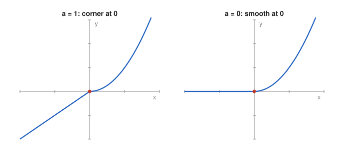

# Problem 14 — Continuity and Differentiability of a Piecewise Function

## The Problem

Investigate the behavior at $x=0$ of

$$
f(x)=
\begin{cases}
x^2,&x\ge0, \\
ax,&x<0.
\end{cases}
$$

For which values of $a$ is the function continuous? For which values do the one-sided derivatives exist and agree? For which value of $a$ is the function differentiable? Explain why continuity alone is not sufficient.

---

## What Are We Looking For?

We want to separate two properties at $x=0$: continuity (no jump) and differentiability (no corner), and to find the values of $a$ for which each holds.

---

## Idea and Theorem Before the Calculation

**Continuity at $0$:** $\lim_{x\to0^-}f(x)=\lim_{x\to0^+}f(x)=f(0)$.

**One-sided derivatives:**

$$
f'_-(0)=\lim_{h\to0^-}\frac{f(h)-f(0)}{h},\qquad f'_+(0)=\lim_{h\to0^+}\frac{f(h)-f(0)}{h}.
$$

**Differentiability:** $f'(0)$ exists if and only if both one-sided derivatives exist and are equal.

**Fact:** Differentiability implies continuity, but not conversely.

---

## Step-by-Step Solution

**Step 1: Continuity.**

$$
f(0)=0^2=0,\qquad \lim_{x\to0^+}x^2=0,\qquad \lim_{x\to0^-}ax=0.
$$

All three are $0$ for every $a$, so $f$ is continuous at $0$ for **every** $a\in\mathbb{R}$.

**Step 2: Right-hand derivative.**

For $h>0$:

$$
\frac{f(h)-f(0)}{h}=\frac{h^2}{h}=h\longrightarrow0,\qquad f'_+(0)=0.
$$

**Step 3: Left-hand derivative.**

For $h<0$:

$$
\frac{f(h)-f(0)}{h}=\frac{ah}{h}=a,\qquad f'_-(0)=a.
$$

Both one-sided derivatives exist for every $a$.

**Step 4: Agreement.**

They agree if and only if

$$
a=0.
$$

So $f$ is differentiable at $0$ only for $a=0$, and then $f'(0)=0$.

---

## Sketch

---

## Why Continuity Is Not Enough

Continuity only says that the two pieces meet at the same point. Differentiability also requires that they meet with the same slope. For $a=1$ the graph is the line $y=x$ on the left and the parabola $y=x^2$ on the right; they meet at the origin, but the line has slope $1$ and the parabola slope $0$, producing a corner where no single tangent line exists.

---

## Final Answer in Words

- $f$ is continuous at $0$ for every $a$.
- The one-sided derivatives exist for every $a$: $f'_-(0)=a$ and $f'_+(0)=0$.
- They agree, and $f$ is differentiable at $0$, only for $a=0$, with $f'(0)=0$.

Continuity is not sufficient because it does not control the slopes of the two pieces.

---

## Quick Verification

For $a=0$, the function is $0$ for $x<0$ and $x^2$ for $x\ge0$, and the difference quotient is $0$ from the left and $h$ from the right, both tending to $0$. For $a=2$, with $h=\pm0.01$: from the right $\frac{0.0001}{0.01}=0.01$, from the left $\frac{-0.02}{-0.01}=2$, clearly different.

---

## Common Mistakes

- **Concluding "continuous, hence differentiable":** the implication goes only the other way.
- **Comparing the formulas $x^2$ and $ax$ instead of their slopes:** the values agree at $0$ for every $a$.
- **Using derivative formulas at the boundary point without checking:** one-sided derivatives should be computed from the definition.

---

## Oral Explanation (3 sentences)

Both pieces of the function give the value $0$ at $x=0$, so the function is continuous there for every $a$. The right-hand derivative is $0$, coming from the parabola, and the left-hand derivative is $a$, coming from the line, so they agree only when $a=0$. This shows that continuity alone is not enough: the pieces must also meet with the same slope, otherwise the graph has a corner.
