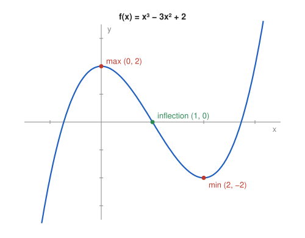

# Problem 1 — A Cubic Polynomial

## The Problem

Analyze the monotonicity and extrema of

$$
f(x)=x^3-3x^2+2.
$$

Sketch the graph based on the results and mark the critical points.

---

## What Are We Looking For?

We want the intervals where the cubic increases or decreases, its local maximum and minimum, and a sketch built from this information.

---

## Idea and Theorem Before the Calculation

**Monotonicity test:** If $f'>0$ on an interval, $f$ is increasing there; if $f'<0$, decreasing.

**First derivative test:** At a critical point ($f'(x_0)=0$), a sign change of $f'$ from $+$ to $-$ gives a local maximum, from $-$ to $+$ a local minimum.

**Second derivative:** $f''$ changes sign at an inflection point, where the curvature changes.

---

## Step-by-Step Solution

**Step 1: Derivative and critical points.**

$$
f'(x)=3x^2-6x=3x(x-2),
$$

so $f'(x)=0$ for $x=0$ and $x=2$.

**Step 2: Sign chart.**

$f'$ is an upward parabola with zeros $0$ and $2$:

| interval | $(-\infty,0)$ | $(0,2)$ | $(2,\infty)$ |
|---|---|---|---|
| test point | $-1$ | $1$ | $3$ |
| $f'$ | $9>0$ | $-3<0$ | $9>0$ |
| $f$ | increasing | decreasing | increasing |

**Step 3: Extrema.**

- At $x=0$ the sign changes from $+$ to $-$: local maximum $f(0)=2$.
- At $x=2$ the sign changes from $-$ to $+$: local minimum $f(2)=8-12+2=-2$.

**Step 4: Additional features for the sketch.**

- Inflection: $f''(x)=6x-6=0$ at $x=1$, $f(1)=0$; concave for $x<1$, convex for $x>1$.
- Zeros: $f(1)=0$, so $f(x)=(x-1)(x^2-2x-2)$, with roots $x=1$ and $x=1\pm\sqrt3$ ($\approx-0.73$ and $\approx2.73$).
- Limits: $f(x)\to-\infty$ as $x\to-\infty$, and $f(x)\to+\infty$ as $x\to+\infty$.

---

## Sketch

---

## Final Answer in Words

$f$ is increasing on $(-\infty,0]$ and on $[2,\infty)$, and decreasing on $[0,2]$. It has a local maximum $f(0)=2$ and a local minimum $f(2)=-2$. The graph rises from $-\infty$, turns down at $(0,2)$, passes through the inflection point $(1,0)$, turns up at $(2,-2)$, and rises to $+\infty$.

---

## Quick Verification

The cubic is symmetric about its inflection point $(1,0)$: $f(1+t)=t^3-3t$, which is odd in $t$. The maximum and minimum are therefore mirror images, $(1-1,\,2)$ and $(1+1,\,-2)$, which matches the computed extrema.

---

## Common Mistakes

- **Calling every critical point an extremum:** the sign change must be checked.
- **Writing "increasing on $(-\infty,0)\cup(2,\infty)$":** monotonicity is stated separately on each interval.
- **Confusing the location with the value:** the maximum is at $x=0$, and its value is $2$.

---

## Oral Explanation (3 sentences)

The derivative $3x(x-2)$ is zero at $0$ and $2$, positive outside these points and negative between them. So the function increases up to $x=0$, decreases until $x=2$ and then increases again, with a local maximum $2$ at $x=0$ and a local minimum $-2$ at $x=2$. Together with the inflection point $(1,0)$ and the limits at $\pm\infty$, this gives the typical S-shaped graph of a cubic.
