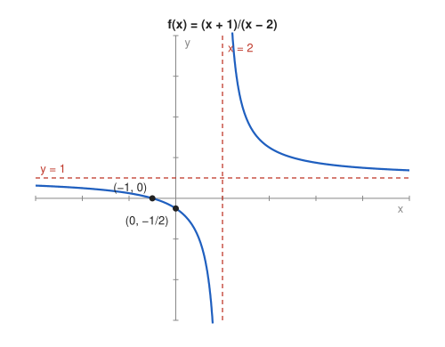

# Problem 3 — A Rational Function

## The Problem

Analyze the domain, zeros, asymptotes, and monotonicity of

$$
f(x)=\frac{x+1}{x-2}.
$$

Finally, sketch a graph consistent with all the information obtained.

---

## What Are We Looking For?

We want a complete description of a simple rational function: where it is defined, where it crosses the axes, which lines it approaches, where it increases or decreases, and a sketch.

---

## Idea and Theorem Before the Calculation

**Vertical asymptote:** at a zero of the denominator where the numerator is nonzero.

**Horizontal asymptote:** $\lim_{x\to\pm\infty}f(x)$, found by dominant terms.

**Monotonicity:** from the sign of $f'$, separately on each interval of the domain.

---

## Step-by-Step Solution

**Step 1: Domain.**

$$
D_f=\mathbb{R}\setminus\{2\}=(-\infty,2)\cup(2,\infty).
$$

**Step 2: Zeros and $y$-intercept.**

$f(x)=0\iff x+1=0\iff x=-1$. Also $f(0)=\frac{1}{-2}=-\frac12$.

**Step 3: Vertical asymptote $x=2$.**

Near $x=2$ the numerator is close to $3>0$:

$$
\lim_{x\to2^-}f(x)=-\infty,\qquad \lim_{x\to2^+}f(x)=+\infty.
$$

**Step 4: Horizontal asymptote.**

$$
\lim_{x\to\pm\infty}\frac{x+1}{x-2}=\lim_{x\to\pm\infty}\frac{1+\frac1x}{1-\frac2x}=1,
$$

so $y=1$ is a horizontal asymptote on both sides.

**Step 5: Monotonicity.**

$$
f'(x)=\frac{1\cdot(x-2)-(x+1)\cdot1}{(x-2)^2}=\frac{-3}{(x-2)^2}<0\qquad(x\neq2).
$$

$f$ is decreasing on $(-\infty,2)$ and decreasing on $(2,\infty)$. There are no extrema.

---

## Sketch

Left branch: from just below $y=1$ at $-\infty$, through $(-1,0)$ and $(0,-\frac12)$, down to $-\infty$ at $x=2$. Right branch: from $+\infty$ at $x=2$ down towards $y=1$.

---

## Final Answer in Words

- Domain: $x\neq2$.
- Zero: $x=-1$; $y$-intercept $-\frac12$.
- Asymptotes: vertical $x=2$, horizontal $y=1$.
- Monotonicity: decreasing on $(-\infty,2)$ and on $(2,\infty)$ separately; no extrema.

---

## Quick Verification

Division gives $f(x)=1+\frac{3}{x-2}$, the hyperbola $\frac{3}{x}$ shifted right by $2$ and up by $1$. This explains every feature: asymptotes $x=2$ and $y=1$, and decreasing branches. Note also that $f(1)=-2<f(3)=4$, so $f$ is **not** decreasing on the whole domain, only on each branch.

---

## Common Mistakes

- **"Decreasing on $\mathbb{R}\setminus\{2\}$":** false, as $f(1)<f(3)$ shows; monotonicity holds on each interval separately.
- **Missing the sign on each side of the asymptote:** the branches go to opposite infinities.
- **Taking $y=0$ as horizontal asymptote:** the degrees are equal, so the asymptote is the ratio of leading coefficients, $y=1$.

---

## Oral Explanation (3 sentences)

The function is defined for $x\neq2$, crosses the $x$-axis at $-1$, and has a vertical asymptote $x=2$ and a horizontal asymptote $y=1$. Its derivative $-\frac{3}{(x-2)^2}$ is negative everywhere in the domain, so each branch is decreasing and there are no extrema. The graph is a hyperbola centered at $(2,1)$, with one branch in the lower left and one in the upper right.
