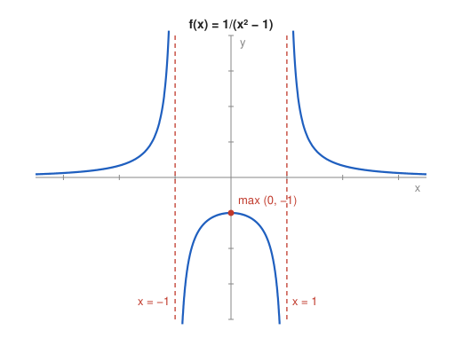

# Problem 4 — A Function with Two Vertical Asymptotes

## The Problem

Analyze

$$
f(x)=\frac1{x^2-1}.
$$

Determine the domain, asymptotes, sign, and monotonicity on the intervals of the domain. Explain why each interval must be analyzed separately.

---

## What Are We Looking For?

We want a description of $f$ on each of the three intervals into which the two excluded points divide the real line.

---

## Idea and Theorem Before the Calculation

**Domain splits the line:** $x^2-1=0$ at $x=\pm1$, so the domain consists of three separate intervals.

**Monotonicity test:** The sign of $f'$ describes $f$ on an interval; conclusions cannot jump over a point where $f$ is undefined.

**Symmetry:** $f(-x)=f(x)$, so $f$ is even and its graph is symmetric about the $y$-axis.

---

## Step-by-Step Solution

**Step 1: Domain.**

$$
D_f=(-\infty,-1)\cup(-1,1)\cup(1,\infty).
$$

**Step 2: Sign.**

$f$ has the sign of $x^2-1$: positive for $|x|>1$, negative for $|x|<1$. There are no zeros.

**Step 3: Vertical asymptotes.**

Using the sign of $x^2-1$ on each side:

$$
\lim_{x\to-1^-}f=+\infty,\quad \lim_{x\to-1^+}f=-\infty,\quad \lim_{x\to1^-}f=-\infty,\quad \lim_{x\to1^+}f=+\infty.
$$

So $x=-1$ and $x=1$ are vertical asymptotes.

**Step 4: Horizontal asymptote.**

$$
\lim_{x\to\pm\infty}\frac{1}{x^2-1}=0,
$$

so $y=0$ is a horizontal asymptote on both sides.

**Step 5: Derivative and monotonicity.**

$$
f'(x)=-\frac{2x}{(x^2-1)^2}.
$$

The denominator is positive, so $f'$ has the sign of $-x$:

| interval | $(-\infty,-1)$ | $(-1,0)$ | $(0,1)$ | $(1,\infty)$ |
|---|---|---|---|---|
| $f'$ | $+$ | $+$ | $-$ | $-$ |
| $f$ | increasing | increasing | decreasing | decreasing |

**Step 6: Extremum.** On $(-1,1)$, $f'$ changes from $+$ to $-$ at $0$: local maximum $f(0)=-1$.

---

## Sketch

---

## Why Each Interval Separately

The derivative is positive on $(-\infty,-1)$ and on $(-1,0)$, but $f$ is not increasing on their union: $f(-2)=\frac13$ while $f(-\frac12)=-\frac43$, a smaller value at a larger argument. Between the two intervals the graph jumps from $+\infty$ to $-\infty$ across the asymptote, and the monotonicity test only works on an interval where $f$ is defined and differentiable at every point.

---

## Final Answer in Words

- Domain: all $x$ except $\pm1$; the function is even.
- Sign: positive for $|x|>1$, negative for $|x|<1$; no zeros.
- Asymptotes: vertical $x=\pm1$, horizontal $y=0$.
- Monotonicity: increasing on $(-\infty,-1)$ and on $(-1,0]$, decreasing on $[0,1)$ and on $(1,\infty)$; local maximum $f(0)=-1$.

---

## Quick Verification

On $(-1,1)$ we have $0\le x^2<1$, so $-1\le x^2-1<0$ and $f(x)=\frac{1}{x^2-1}\le-1$, with equality only at $0$. This confirms the maximum value $-1$ on the middle interval without derivatives.

---

## Common Mistakes

- **Merging intervals across an asymptote:** see the counterexample $f(-2)>f(-\frac12)$.
- **Calling $(0,-1)$ a global maximum:** on the outer intervals $f$ takes positive values.
- **Wrong signs at the asymptotes:** check the sign of $x^2-1$ on each side.

---

## Oral Explanation (3 sentences)

The function is undefined at $x=\pm1$, which splits the domain into three intervals and produces two vertical asymptotes, while far away the graph approaches $y=0$. The derivative $-\frac{2x}{(x^2-1)^2}$ is positive for $x<0$ and negative for $x>0$, so on the middle interval the function rises to a maximum of $-1$ at $0$, and the outer branches rise and fall towards the asymptotes. Each interval must be treated separately, because the graph jumps across the asymptotes and monotonicity cannot be carried over such a gap.
