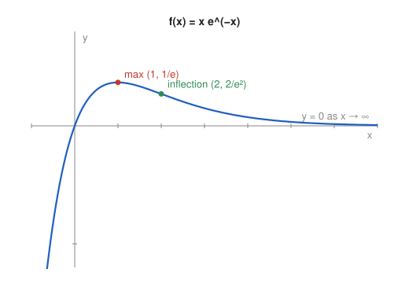

# Problem 5 — An Exponential Function with a Maximum

## The Problem

Analyze the monotonicity and extrema of

$$
f(x)=xe^{-x}.
$$

Also examine the behavior as $x\to\infty$ and explain how the limit affects the shape of the graph on the right-hand side.

---

## What Are We Looking For?

We want the intervals of monotonicity and the extremum of $xe^{-x}$, its limits at the ends, and the shape of the graph for large $x$.

---

## Idea and Theorem Before the Calculation

**Product and chain rules:** $(e^{-x})'=-e^{-x}$.

**Exponential beats polynomial:** $\lim_{x\to\infty}\frac{x}{e^x}=0$.

**First derivative test** for the type of extremum.

---

## Step-by-Step Solution

**Step 1: Derivative.**

$$
f'(x)=e^{-x}+x\cdot(-e^{-x})=e^{-x}(1-x).
$$

**Step 2: Sign.** Since $e^{-x}>0$, the sign of $f'$ is the sign of $1-x$:

- $f'(x)>0$ for $x<1$: increasing on $(-\infty,1]$,
- $f'(x)<0$ for $x>1$: decreasing on $[1,\infty)$.

**Step 3: Extremum.**

The sign changes from $+$ to $-$ at $x=1$: maximum

$$
f(1)=\frac{1}{e}\approx0.368.
$$

It is a global maximum, because $f$ increases up to $1$ and decreases afterwards.

**Step 4: Limits.**

$$
\lim_{x\to\infty}xe^{-x}=\lim_{x\to\infty}\frac{x}{e^x}=0,\qquad \lim_{x\to-\infty}xe^{-x}=-\infty.
$$

For $x\to-\infty$ both factors $x\to-\infty$ and $e^{-x}\to+\infty$ push the product to $-\infty$.

**Step 5: Zero and curvature.**

$f(0)=0$ is the only zero. $f''(x)=e^{-x}(x-2)$, so the graph is concave for $x<2$, convex for $x>2$, with inflection point $(2,\frac{2}{e^2})$.

---

## Sketch

---

## How the Limit Shapes the Right Side

After the maximum, $f$ decreases, but it stays positive for $x>0$ and tends to $0$. So the right part of the graph is a tail that approaches the $x$-axis from above without touching it: $y=0$ is a horizontal asymptote on the right. Because the graph falls towards a horizontal line, it must eventually flatten and bend upward, which is why it becomes convex after the inflection point $x=2$.

---

## Final Answer in Words

$f$ is increasing on $(-\infty,1]$ and decreasing on $[1,\infty)$, with the global maximum $f(1)=\frac1e$. As $x\to\infty$, $f(x)\to0$ from above, so the $x$-axis is a horizontal asymptote on the right; as $x\to-\infty$, $f(x)\to-\infty$.

---

## Quick Verification

$f(0.5)\approx0.303$, $f(1)\approx0.368$, $f(2)\approx0.271$, $f(5)\approx0.034$: the values rise to the maximum at $1$ and then decay towards $0$, as predicted.

---

## Common Mistakes

- **$(e^{-x})'=e^{-x}$:** the chain rule gives $-e^{-x}$.
- **Claiming no horizontal asymptote:** on the right, $y=0$ is one.
- **Thinking the graph crosses the $x$-axis again:** $xe^{-x}>0$ for every $x>0$.

---

## Oral Explanation (3 sentences)

The derivative $e^{-x}(1-x)$ is positive before $x=1$ and negative after it, so the function rises to its maximum value $\frac1e$ at $x=1$ and then falls. As $x\to\infty$ the exponential in the denominator wins, so $xe^{-x}\to0$ and the graph approaches the $x$-axis from above. This limit is why the right side of the graph is a flattening tail with a horizontal asymptote $y=0$.
