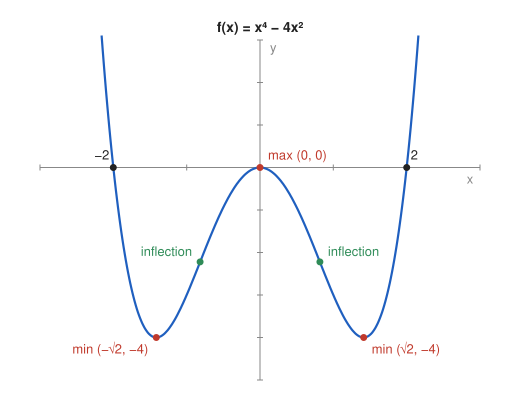

# Problem 8 — The Second Derivative

## The Problem

For

$$
f(x)=x^4-4x^2
$$

find the local extrema, intervals of convexity and concavity, and inflection points. Sketch the graph and mark all the identified features on it.

---

## What Are We Looking For?

We want the extrema from the first derivative, the curvature from the second derivative, and a sketch with all these features.

---

## Idea and Theorem Before the Calculation

**First derivative:** sign changes of $f'$ locate local extrema.

**Second derivative:** $f''>0$ on an interval means the graph is convex (bends upward), $f''<0$ means concave (bends downward). An inflection point is where $f''$ changes sign.

**Symmetry:** $f(-x)=f(x)$, so the graph is symmetric about the $y$-axis.

---

## Step-by-Step Solution

**Step 1: First derivative.**

$$
f'(x)=4x^3-8x=4x(x^2-2)=4x(x-\sqrt2)(x+\sqrt2).
$$

Critical points: $x=-\sqrt2,\ 0,\ \sqrt2$.

**Step 2: Sign of $f'$.**

| interval | $(-\infty,-\sqrt2)$ | $(-\sqrt2,0)$ | $(0,\sqrt2)$ | $(\sqrt2,\infty)$ |
|---|---|---|---|---|
| test point | $-2$ | $-1$ | $1$ | $2$ |
| $f'$ | $-16$ | $4$ | $-4$ | $16$ |
| $f$ | decreasing | increasing | decreasing | increasing |

**Step 3: Extrema.**

- local minima at $x=\pm\sqrt2$: $f(\pm\sqrt2)=4-8=-4$,
- local maximum at $x=0$: $f(0)=0$.

**Step 4: Second derivative.**

$$
f''(x)=12x^2-8=0\iff x^2=\frac23\iff x=\pm\sqrt{\frac23}\approx\pm0.816.
$$

- $|x|>\sqrt{2/3}$: $f''>0$, convex,
- $|x|<\sqrt{2/3}$: $f''<0$, concave.

**Step 5: Inflection points.**

$$
f\left(\pm\sqrt{\tfrac23}\right)=\frac49-\frac83=-\frac{20}{9}.
$$

Inflection points: $\left(\pm\sqrt{2/3},\,-\frac{20}{9}\right)$.

**Step 6: Zeros.** $x^2(x^2-4)=0$ gives $x=0$ and $x=\pm2$.

---

## Sketch

---

## Final Answer in Words

- Local maximum: $f(0)=0$. Local (and global) minima: $f(\pm\sqrt2)=-4$.
- Convex on $\left(-\infty,-\sqrt{2/3}\right]$ and $\left[\sqrt{2/3},\infty\right)$, concave on $\left[-\sqrt{2/3},\sqrt{2/3}\right]$.
- Inflection points: $\left(\pm\sqrt{2/3},-\frac{20}{9}\right)$.

The graph is a "W": it falls to $-4$, rises to the bump at the origin, and falls and rises again symmetrically.

---

## Quick Verification

Second derivative test at the critical points: $f''(0)=-8<0$ (maximum) and $f''(\pm\sqrt2)=24-8=16>0$ (minima), consistent with the sign chart. Completing the square, $f(x)=(x^2-2)^2-4\ge-4$, with equality exactly at $x^2=2$.

---

## Common Mistakes

- **Missing the critical point $0$:** it comes from the factor $4x$.
- **Treating inflection points as extrema:** at $\pm\sqrt{2/3}$ the curvature changes, not the direction of motion.
- **Mixing up convex and concave:** $f''>0$ means the graph holds water (bends up).

---

## Oral Explanation (3 sentences)

The first derivative $4x(x^2-2)$ shows that the function decreases, increases, decreases and increases again, with minima $-4$ at $\pm\sqrt2$ and a local maximum $0$ at the origin. The second derivative $12x^2-8$ is negative between $\pm\sqrt{2/3}$ and positive outside, so the graph is concave in the middle and convex on the sides. The points where the curvature changes, $\left(\pm\sqrt{2/3},-\frac{20}{9}\right)$, are the inflection points of this W-shaped graph.
