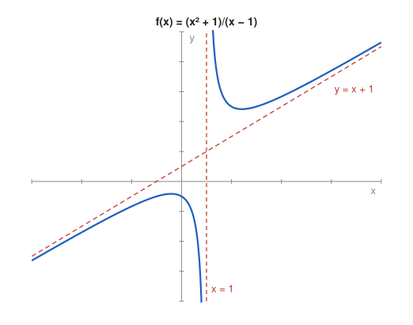

# Problem 9 — An Oblique Asymptote

## The Problem

Analyze the asymptotes of

$$
f(x)=\frac{x^2+1}{x-1}.
$$

Perform polynomial division and explain why the remainder term vanishes for large $|x|$.

---

## What Are We Looking For?

We want all asymptotes of the function: the vertical one from the zero of the denominator, and an oblique one obtained by polynomial division.

---

## Idea and Theorem Before the Calculation

**Oblique asymptote:** The line $y=mx+b$ is an asymptote at $\pm\infty$ if

$$
\lim_{x\to\pm\infty}\left(f(x)-(mx+b)\right)=0.
$$

**Polynomial division:** $\frac{P(x)}{Q(x)}=S(x)+\frac{R(x)}{Q(x)}$ with $\deg R<\deg Q$. If $\deg P=\deg Q+1$, the quotient $S$ is linear and is the oblique asymptote.

---

## Step-by-Step Solution

**Step 1: Domain and vertical asymptote.**

$D_f=\mathbb{R}\setminus\{1\}$. At $x=1$ the numerator equals $2\neq0$:

$$
\lim_{x\to1^-}f(x)=-\infty,\qquad \lim_{x\to1^+}f(x)=+\infty.
$$

So $x=1$ is a vertical asymptote.

**Step 2: Polynomial division.**

$$
x^2+1=(x-1)(x+1)+2,
$$

therefore

$$
f(x)=x+1+\frac{2}{x-1}.
$$

Check: $(x-1)(x+1)+2=x^2-1+2=x^2+1$.

**Step 3: Oblique asymptote.**

$$
f(x)-(x+1)=\frac{2}{x-1}\longrightarrow0\qquad(x\to\pm\infty).
$$

So $y=x+1$ is an oblique asymptote at both $+\infty$ and $-\infty$. There is no horizontal asymptote, because $f(x)\to\pm\infty$.

**Step 4: Position relative to the asymptote.**

$\frac{2}{x-1}>0$ for $x>1$ and $<0$ for $x<1$, so the graph lies above the line $y=x+1$ on the right and below it on the left.

---

## Sketch

---

## Why the Remainder Vanishes

After division, everything that grows is collected in the polynomial part $x+1$, and what remains is a fraction whose numerator has a lower degree than the denominator. For large $|x|$ the constant $2$ is divided by the large number $x-1$, so the remainder becomes as small as we like. Geometrically, the vertical distance between the graph and the line $y=x+1$ shrinks to zero.

---

## Final Answer in Words

The function has a vertical asymptote $x=1$ and an oblique asymptote $y=x+1$ at both ends. The decomposition $f(x)=x+1+\frac{2}{x-1}$ shows that the difference between the graph and the line is $\frac{2}{x-1}$, which tends to $0$ as $|x|\to\infty$.

---

## Quick Verification

The standard formulas give the same line: $m=\lim\frac{f(x)}{x}=\lim\frac{x^2+1}{x^2-x}=1$ and $b=\lim(f(x)-x)=\lim\frac{x+1}{x-1}=1$. Numerically, $f(101)=\frac{10202}{100}=102.02$, while the asymptote gives $102$.

---

## Common Mistakes

- **Concluding "no asymptote at infinity" because there is no horizontal one:** the asymptote can be oblique.
- **Division error:** the remainder is $2$, not $0$ or $1$.
- **Forgetting the vertical asymptote:** the analysis must include the zero of the denominator.

---

## Oral Explanation (3 sentences)

The denominator vanishes at $x=1$ while the numerator does not, so $x=1$ is a vertical asymptote. Polynomial division gives $f(x)=x+1+\frac{2}{x-1}$, and since the remainder $\frac{2}{x-1}$ tends to zero for large $|x|$, the graph approaches the line $y=x+1$. This line is an oblique asymptote, and the graph lies above it for $x>1$ and below it for $x<1$.
