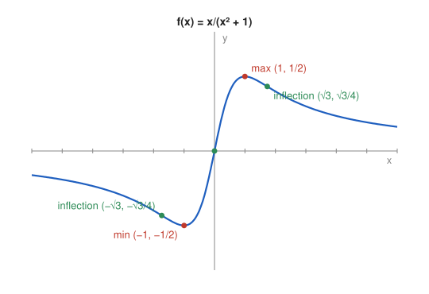

# Problem 10 — Complete Function Analysis

## The Problem

Perform a complete analysis of

$$
f(x)=\frac{x}{x^2+1}.
$$

Include the domain, symmetry, zeros, limits, monotonicity, extrema, and convexity. Finally, produce a sketch based only on this information.

---

## What Are We Looking For?

We want every standard feature of the function, collected step by step, and a sketch built from these features.

---

## Idea and Theorem Before the Calculation

We use the standard sequence: domain, symmetry, zeros and sign, limits and asymptotes, first derivative (monotonicity, extrema), second derivative (convexity, inflection points), and finally the sketch.

---

## Step-by-Step Solution

**Step 1: Domain.** $x^2+1>0$ for all $x$, so $D_f=\mathbb{R}$.

**Step 2: Symmetry.**

$$
f(-x)=\frac{-x}{x^2+1}=-f(x),
$$

so $f$ is odd and its graph is symmetric about the origin.

**Step 3: Zeros and sign.** $f(x)=0\iff x=0$. Since the denominator is positive, $f$ has the sign of $x$.

**Step 4: Limits.**

$$
\lim_{x\to\pm\infty}\frac{x}{x^2+1}=\lim_{x\to\pm\infty}\frac{\frac1x}{1+\frac{1}{x^2}}=0.
$$

$y=0$ is a horizontal asymptote; there are no vertical asymptotes.

**Step 5: First derivative.**

$$
f'(x)=\frac{(x^2+1)-x\cdot2x}{(x^2+1)^2}=\frac{1-x^2}{(x^2+1)^2}.
$$

$f'>0$ for $|x|<1$ and $f'<0$ for $|x|>1$: decreasing on $(-\infty,-1]$, increasing on $[-1,1]$, decreasing on $[1,\infty)$.

**Step 6: Extrema.**

- minimum at $x=-1$: $f(-1)=-\frac12$,
- maximum at $x=1$: $f(1)=\frac12$.

Since $f\to0$ at both ends, these are global.

**Step 7: Second derivative.**

$$
f''(x)=\frac{2x(x^2-3)}{(x^2+1)^3}.
$$

Zeros: $x=0$ and $x=\pm\sqrt3$. Signs:

| interval | $(-\infty,-\sqrt3)$ | $(-\sqrt3,0)$ | $(0,\sqrt3)$ | $(\sqrt3,\infty)$ |
|---|---|---|---|---|
| $f''$ | $-$ | $+$ | $-$ | $+$ |
| graph | concave | convex | concave | convex |

**Step 8: Inflection points.**

$$
(0,0),\qquad \left(\sqrt3,\frac{\sqrt3}{4}\right),\qquad \left(-\sqrt3,-\frac{\sqrt3}{4}\right).
$$

---

## Sketch

The graph comes from $0^-$ at $-\infty$, falls to the minimum $(-1,-\frac12)$, rises through the origin to the maximum $(1,\frac12)$, and decays to $0^+$.

---

## Final Answer in Words

$f$ is defined on $\mathbb{R}$, odd, zero only at $0$, negative for $x<0$ and positive for $x>0$, with the horizontal asymptote $y=0$. It decreases on $(-\infty,-1]$, increases on $[-1,1]$, and decreases on $[1,\infty)$, with global minimum $-\frac12$ at $x=-1$ and global maximum $\frac12$ at $x=1$. It has three inflection points, at $x=0$ and $x=\pm\sqrt3$.

---

## Quick Verification

The bound $|f(x)|\le\frac12$ follows from $x^2+1\ge2|x|$, i.e. $(|x|-1)^2\ge0$, with equality exactly at $|x|=1$. This confirms the extreme values without derivatives.

---

## Common Mistakes

- **Sign error in the quotient rule:** the numerator is $(x^2+1)-2x^2=1-x^2$.
- **Missing inflection points at $\pm\sqrt3$:** the factor $x^2-3$ of $f''$ gives two of them.
- **Ignoring symmetry:** oddness halves the work and checks the results.

---

## Oral Explanation (3 sentences)

The function is defined everywhere, is odd, and tends to zero at both ends, so the $x$-axis is a horizontal asymptote. Its derivative $\frac{1-x^2}{(x^2+1)^2}$ shows a minimum of $-\frac12$ at $x=-1$ and a maximum of $\frac12$ at $x=1$, and its second derivative changes sign at $0$ and $\pm\sqrt3$, giving three inflection points. Putting this together, the graph is an S-shaped wave through the origin that flattens out towards the $x$-axis.
