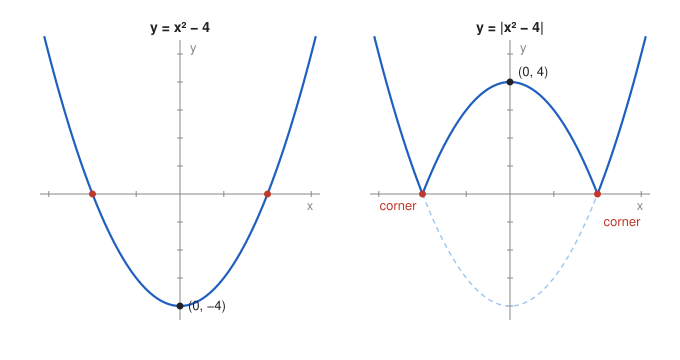

# Problem 12 — A Function with an Absolute Value

## The Problem

Analyze

$$
f(x)=|x^2-4|.
$$

First sketch $x^2-4$, then explain the effect of the absolute value. Indicate the points where the derivative does not exist and justify the reason geometrically.

---

## What Are We Looking For?

We want to understand how the absolute value changes the graph of the parabola $x^2-4$, to describe the resulting function, and to find the points where it has no derivative.

---

## Idea and Theorem Before the Calculation

**Absolute value:** $|g(x)|=g(x)$ where $g(x)\ge0$, and $|g(x)|=-g(x)$ where $g(x)<0$. Geometrically, the parts of the graph below the $x$-axis are reflected upward.

**Differentiability:** $f'(x_0)$ exists only if the left and right derivatives at $x_0$ agree.

---

## Step-by-Step Solution

**Step 1: The parabola $g(x)=x^2-4$.**

Upward parabola with vertex $(0,-4)$ and zeros $x=\pm2$. It is negative on $(-2,2)$.

**Step 2: Piecewise formula.**

$$
f(x)=
\begin{cases}
x^2-4, & |x|\ge2, \\
4-x^2, & |x|<2.
\end{cases}
$$

The part on $(-2,2)$ is reflected: the valley with bottom $(0,-4)$ becomes a hill with top $(0,4)$.

**Step 3: Derivative where it exists.**

$$
f'(x)=
\begin{cases}
2x, & |x|>2, \\
-2x, & |x|<2.
\end{cases}
$$

**Step 4: The points $x=\pm2$.**

At $x=2$:

$$
f'_-(2)=-2\cdot2=-4,\qquad f'_+(2)=2\cdot2=4.
$$

The one-sided derivatives differ, so $f'(2)$ does not exist. By symmetry, at $x=-2$ the one-sided derivatives are $-4$ and $4$, and $f'(-2)$ does not exist either.

**Step 5: Monotonicity and extrema.**

- decreasing on $(-\infty,-2]$, increasing on $[-2,0]$, decreasing on $[0,2]$, increasing on $[2,\infty)$,
- global minima $f(\pm2)=0$ (at the corners),
- local maximum $f(0)=4$, where $f'(0)=0$.

---

## Sketch

---

## Geometric Reason for the Missing Derivative

At $x=2$ the original parabola crosses the axis with slope $4$. The reflection turns the part just to the left of $2$ upside down, so there the graph arrives with slope $-4$, while to the right it leaves with slope $4$. Two different slopes meet at one point, forming a sharp corner, and no single tangent line fits it. At $x=0$ there is no such problem: the reflected hill is smooth, with a horizontal tangent.

---

## Final Answer in Words

$f(x)=|x^2-4|$ equals $x^2-4$ for $|x|\ge2$ and $4-x^2$ for $|x|<2$. It has minima $0$ at $x=\pm2$ and a local maximum $4$ at $x=0$. The derivative exists everywhere except at $x=\pm2$, where the reflected and unreflected parts meet at corners with slopes $\mp4$ and $\pm4$.

---

## Quick Verification

Difference quotients at $2$ with $h=\pm0.01$: $\frac{f(2.01)-0}{0.01}=\frac{0.0401}{0.01}=4.01$ and $\frac{f(1.99)-0}{-0.01}=\frac{0.0399}{-0.01}=-3.99$, approaching $4$ and $-4$, which confirms the corner.

---

## Common Mistakes

- **Differentiating $|g|$ as $|g'|$:** $|2x|$ is not the derivative of $|x^2-4|$.
- **Saying the derivative fails at $x=0$:** the top of the hill is smooth.
- **Claiming no minimum because $f'$ never equals $0$ there:** extrema can occur where $f'$ does not exist.

---

## Oral Explanation (3 sentences)

The parabola $x^2-4$ is negative between $-2$ and $2$, and the absolute value reflects this part upward, turning the valley into a hill with top $(0,4)$. Away from $\pm2$ the function is a smooth parabola, so its derivative is $2x$ or $-2x$. At $x=\pm2$ the graph arrives with slope $\mp4$ and leaves with slope $\pm4$, so it has a corner and the derivative does not exist there.
