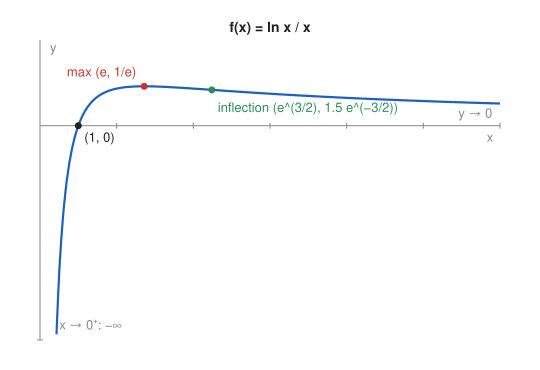

# Problem 13 — A Logarithm and an Asymptote

## The Problem

Perform a complete analysis of

$$
f(x)=\frac{\ln x}{x},\qquad x>0.
$$

Find the maximum and the behavior at the ends of the domain. Explain which information is necessary for a correct sketch.

---

## What Are We Looking For?

We want the zero, the sign, the limits at $0^+$ and $+\infty$, the monotonicity, the maximum, the convexity, and a sketch of $\frac{\ln x}{x}$.

---

## Idea and Theorem Before the Calculation

**Domain:** $x>0$ because of $\ln x$.

**Growth comparison:** $\lim_{x\to\infty}\frac{\ln x}{x}=0$; the logarithm grows more slowly than any positive power of $x$.

**Quotient rule** for $f'$ and $f''$.

---

## Step-by-Step Solution

**Step 1: Zero and sign.** $f(x)=0\iff\ln x=0\iff x=1$. Since $x>0$, $f$ has the sign of $\ln x$: negative on $(0,1)$, positive on $(1,\infty)$.

**Step 2: Limits at the ends.**

$$
\lim_{x\to0^+}\frac{\ln x}{x}=-\infty,
$$

because $\ln x\to-\infty$ and it is multiplied by $\frac1x\to+\infty$. So $x=0$ is a vertical asymptote.

$$
\lim_{x\to\infty}\frac{\ln x}{x}=0,
$$

so $y=0$ is a horizontal asymptote on the right.

**Step 3: First derivative.**

$$
f'(x)=\frac{\frac1x\cdot x-\ln x\cdot1}{x^2}=\frac{1-\ln x}{x^2}.
$$

$f'>0$ for $\ln x<1$, i.e. $0<x<e$; $f'<0$ for $x>e$. So $f$ increases on $(0,e]$ and decreases on $[e,\infty)$.

**Step 4: Maximum.**

$$
f(e)=\frac{\ln e}{e}=\frac1e\approx0.368.
$$

It is the global maximum.

**Step 5: Second derivative.**

$$
f''(x)=\frac{2\ln x-3}{x^3}.
$$

$f''<0$ for $x<e^{3/2}$ (concave) and $f''>0$ for $x>e^{3/2}$ (convex). Inflection point:

$$
\left(e^{3/2},\ \tfrac32e^{-3/2}\right)\approx(4.48,\ 0.335).
$$

---

## Sketch

---

## Information Needed for a Correct Sketch

- **The domain** $x>0$: there is no left half of the graph.
- **The limit at $0^+$:** the graph comes up from $-\infty$ along the $y$-axis.
- **The zero at $x=1$** and the sign: below the axis before $1$, above after.
- **The maximum $(e,\frac1e)$:** the only turning point.
- **The limit $0$ at $+\infty$:** after the maximum the graph does not cross the axis again but approaches it from above.

Without the last item one could draw the graph falling below the axis; without the inflection point one could draw it as concave forever, although it must bend upward to approach a horizontal line.

---

## Final Answer in Words

$f$ is defined for $x>0$, has the zero $x=1$, a vertical asymptote $x=0$ (with $f\to-\infty$) and the horizontal asymptote $y=0$ as $x\to\infty$. It increases on $(0,e]$, decreases on $[e,\infty)$, and has the global maximum $f(e)=\frac1e$. It is concave before $e^{3/2}$ and convex after.

---

## Quick Verification

$f(1)=0$, $f(e)\approx0.368$, $f(e^2)=\frac{2}{e^2}\approx0.271$, $f(10)\approx0.230$: rising to the maximum at $e$ and then slowly decaying. Since $f$ increases before $e$ and decreases after it, equal values come in pairs on opposite sides of $e$, for example $\frac{\ln2}{2}=\frac{\ln4}{4}$, which is equivalent to $2^4=4^2$.

---

## Common Mistakes

- **$\left(\frac{\ln x}{x}\right)'=\frac{1}{x}\cdot\frac{1}{1}$:** the quotient rule is required.
- **Ignoring the limit at $0^+$:** it decides how the graph starts.
- **Thinking the graph becomes negative for large $x$:** $\ln x>0$ for $x>1$.

---

## Oral Explanation (3 sentences)

The function is defined only for $x>0$, starts at $-\infty$ near the $y$-axis, crosses zero at $x=1$, and tends to $0$ from above as $x\to\infty$. Its derivative $\frac{1-\ln x}{x^2}$ is positive before $e$ and negative after, so the global maximum is $\frac1e$ at $x=e$. For a correct sketch we need the domain, both end limits, the zero, the maximum, and the inflection point at $e^{3/2}$, where the decaying tail starts bending upward towards the axis.
