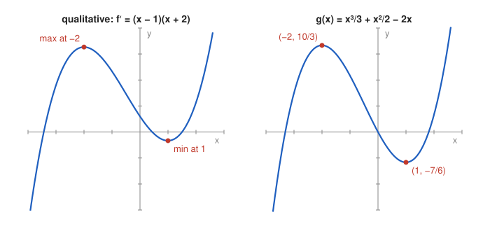

# Problem 14 — Reconstructing Information from the Derivative

## The Problem

It is known that

$$
f'(x)=(x-1)(x+2).
$$

Determine the monotonicity and the locations of the extrema, and sketch a possible qualitative shape of the function. Then, for

$$
g(x)=\frac{x^3}{3}+\frac{x^2}{2}-2x
$$

verify that $g'(x)=(x-1)(x+2)$, and compare the specific graph with the earlier qualitative sketch.

---

## What Are We Looking For?

We want to read the shape of $f$ from its derivative alone, and then compare it with a concrete function $g$ that has this derivative.

---

## Idea and Theorem Before the Calculation

**Monotonicity from $f'$:** the sign of $f'$ alone determines where $f$ increases or decreases and where its extrema are.

**What $f'$ does not determine:** the vertical position. If $g'=f'$ on $\mathbb{R}$, then $f=g+C$ for some constant $C$.

---

## Step-by-Step Solution

**Step 1: Sign of $f'$.**

$f'$ is an upward parabola with zeros $-2$ and $1$:

| interval | $(-\infty,-2)$ | $(-2,1)$ | $(1,\infty)$ |
|---|---|---|---|
| test point | $-3$ | $0$ | $2$ |
| $f'$ | $(-4)(-1)=4>0$ | $(-1)(2)=-2<0$ | $(1)(4)=4>0$ |
| $f$ | increasing | decreasing | increasing |

**Step 2: Extrema.**

- local maximum at $x=-2$ (sign $+\to-$),
- local minimum at $x=1$ (sign $-\to+$).

**Step 3: Qualitative shape.**

The function rises from $-\infty$ (an antiderivative of a quadratic with positive leading coefficient is a cubic with positive leading coefficient), reaches a hill at $x=-2$, falls to a valley at $x=1$, and rises to $+\infty$. The heights of the hill and valley are unknown, only their positions are.

**Step 4: Verify $g'$.**

$$
g'(x)=x^2+x-2=(x-1)(x+2).
$$

Check: $(x-1)(x+2)=x^2+2x-x-2=x^2+x-2$.

**Step 5: Values of $g$.**

$$
g(-2)=-\frac83+2+4=\frac{10}{3},\qquad g(1)=\frac13+\frac12-2=-\frac76,\qquad g(0)=0.
$$

---

## Sketch

---

## Comparison

Both graphs have the same structure: increase, maximum at $x=-2$, decrease, minimum at $x=1$, increase. The qualitative sketch is an arbitrary vertical shift of $g$, since every function with derivative $(x-1)(x+2)$ has the form $g(x)+C$. The specific function adds information that the derivative cannot give: the actual heights $\frac{10}{3}$ and $-\frac76$, and that the graph passes through the origin. The height difference $g(-2)-g(1)=\frac{10}{3}+\frac76=\frac92$ is the same for every $g+C$.

---

## Final Answer in Words

From $f'(x)=(x-1)(x+2)$: $f$ increases on $(-\infty,-2]$, decreases on $[-2,1]$, increases on $[1,\infty)$, with a local maximum at $x=-2$ and a local minimum at $x=1$. The function $g$ satisfies $g'(x)=x^2+x-2=(x-1)(x+2)$, has the maximum $\frac{10}{3}$ and the minimum $-\frac76$, and its graph matches the qualitative sketch up to a vertical shift.

---

## Quick Verification

$\int_{1}^{-2}f'(x)\,dx=g(-2)-g(1)=\frac92$, and $g''(x)=2x+1$ gives $g''(-2)=-3<0$ (maximum) and $g''(1)=3>0$ (minimum), consistent with the sign chart.

---

## Common Mistakes

- **Reading the extrema from the zeros of $f'$ without checking the signs.**
- **Claiming the heights of the extrema can be found from $f'$ alone:** only differences of values are determined.
- **Expansion error:** $(x-1)(x+2)=x^2+x-2$, not $x^2-x-2$.

---

## Oral Explanation (3 sentences)

The derivative $(x-1)(x+2)$ is positive outside $[-2,1]$ and negative inside, so any such function has a hill at $x=-2$ and a valley at $x=1$. The concrete function $g$ indeed has $g'(x)=x^2+x-2=(x-1)(x+2)$, with a maximum $\frac{10}{3}$ and a minimum $-\frac76$. Its graph has exactly the predicted shape, and every other function with the same derivative differs from it only by a vertical shift.
