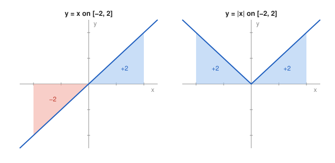

# Problem 12 — Symmetry, Sign, and Absolute Value

## The Problem

Compare

$$
\int_{-2}^{2}x\,dx
$$

and

$$
\int_{-2}^{2}|x|\,dx.
$$

Before calculating, predict the results from symmetry and a sketch, then carry out the calculation and explain the difference.

---

## What Are We Looking For?

We want to predict two definite integrals over a symmetric interval using symmetry, confirm the predictions by computation, and explain why the answers differ.

---

## Idea and Theorem Before the Calculation

**Odd function on a symmetric interval:** If $f(-x)=-f(x)$, then $\int_{-a}^{a}f(x)\,dx=0$.

**Even function on a symmetric interval:** If $f(-x)=f(x)$, then $\int_{-a}^{a}f(x)\,dx=2\int_0^af(x)\,dx$.

$x$ is odd and $|x|$ is even.

---

## Step-by-Step Solution

**Step 1: Prediction.**

- For $y=x$: the triangle on $[-2,0]$ lies below the axis and the triangle on $[0,2]$ above it; they are congruent, each with area $\frac12\cdot2\cdot2=2$. Prediction: $-2+2=0$.
- For $y=|x|$: both triangles lie above the axis. Prediction: $2+2=4$.

**Step 2: Compute $\int_{-2}^2x\,dx$.**

$$
\int_{-2}^{2}x\,dx=\left[\frac{x^2}{2}\right]_{-2}^{2}=2-2=0.
$$

**Step 3: Compute $\int_{-2}^2|x|\,dx$.**

Split at $0$, where the formula for $|x|$ changes:

$$
\int_{-2}^{2}|x|\,dx=\int_{-2}^{0}(-x)\,dx+\int_0^2x\,dx=\left[-\frac{x^2}{2}\right]_{-2}^{0}+\left[\frac{x^2}{2}\right]_0^2=2+2=4.
$$

Both results agree with the predictions.

---

## Explanation of the Difference

The integral of $x$ is a signed area: the negative contribution on $[-2,0]$ cancels the positive contribution on $[0,2]$ exactly, because $x$ is odd. The absolute value turns the left part upward, so nothing cancels, and the integral of $|x|$ is the true geometric area between the graph of $x$ and the axis. Zero signed area does not mean that there is no area.

---

## Final Answer in Words

$$
\int_{-2}^{2}x\,dx=0,\qquad \int_{-2}^{2}|x|\,dx=4.
$$

The first integral vanishes because the odd function $x$ has equal areas below and above the axis that cancel; the second counts both areas positively, which gives $4$.

---

## Quick Verification

By the even-function rule, $\int_{-2}^2|x|\,dx=2\int_0^2x\,dx=2\cdot2=4$. By the odd-function rule, $\int_{-2}^2x\,dx=0$ without any computation.

---

## Common Mistakes

- **Integrating $|x|$ as $\frac{x^2}{2}$ over the whole interval:** this gives $0$, the wrong answer; one must split at $0$.
- **Concluding from $\int x\,dx=0$ that the region has no area.**
- **Writing $\left|\int_{-2}^2x\,dx\right|=\int_{-2}^2|x|\,dx$:** the left side is $0$ and the right side is $4$.

---

## Oral Explanation (3 sentences)

The function $x$ is odd, so on $[-2,2]$ its negative part on the left cancels its positive part on the right, and the integral is $0$. The function $|x|$ is even and nonnegative, so both triangles count positively and the integral is $2+2=4$. The difference shows that a definite integral measures signed area, while the absolute value turns it into ordinary geometric area.
