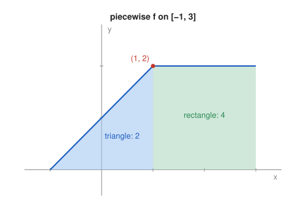

# Problem 14 — A Piecewise-Defined Function

## The Problem

Let

$$
f(x)=
\begin{cases}
x+1,&-1\le x<1, \\
2,&1\le x\le3.
\end{cases}
$$

Sketch the graph, decide where to split the integral, compute

$$
\int_{-1}^{3}f(x)\,dx
$$

and verify the result geometrically.

---

## What Are We Looking For?

We want the integral of a function given by two formulas, computed by splitting at the point where the formula changes, and a geometric check.

---

## Idea and Theorem Before the Calculation

**Additivity over intervals:**

$$
\int_a^cf(x)\,dx=\int_a^bf(x)\,dx+\int_b^cf(x)\,dx.
$$

On each piece we integrate the formula valid there. The value of $f$ at the single point $x=1$ does not affect either integral.

---

## Step-by-Step Solution

**Step 1: Sketch and split point.**

On $[-1,1)$ the graph is the segment from $(-1,0)$ to $(1,2)$; on $[1,3]$ it is the horizontal segment at height $2$. The formula changes at $x=1$, so we split there. Note that $\lim_{x\to1^-}(x+1)=2=f(1)$, so the graph has no jump.

**Step 2: First piece.**

$$
\int_{-1}^{1}(x+1)\,dx=\left[\frac{x^2}{2}+x\right]_{-1}^{1}=\left(\frac12+1\right)-\left(\frac12-1\right)=2.
$$

**Step 3: Second piece.**

$$
\int_1^3 2\,dx=2\cdot(3-1)=4.
$$

**Step 4: Total.**

$$
\int_{-1}^{3}f(x)\,dx=2+4=6.
$$

---

## Geometric Verification

- On $[-1,1]$ the region under the graph is a right triangle with base $2$ and height $2$: area $\frac12\cdot2\cdot2=2$.
- On $[1,3]$ it is a rectangle $2\times2$: area $4$.

The total area is $6$, and since $f\ge0$ on $[-1,3]$, the integral equals this area.

---

## Final Answer in Words

$$
\int_{-1}^{3}f(x)\,dx=6.
$$

The integral is split at $x=1$, where the formula changes; the triangle on $[-1,1]$ contributes $2$ and the rectangle on $[1,3]$ contributes $4$.

---

## Quick Verification

The average value of $f$ on $[-1,3]$ is $\frac{6}{4}=1.5$, which lies between the minimum $0$ and the maximum $2$ of $f$, as it must.

---

## Common Mistakes

- **Integrating one formula over the whole interval:** $\int_{-1}^3(x+1)\,dx=8$ is wrong.
- **Splitting at the wrong point:** the change happens at $x=1$, not at $0$.
- **Worrying about the value at $x=1$:** a single point has no effect on an integral.

---

## Oral Explanation (3 sentences)

The function is given by $x+1$ on $[-1,1)$ and by the constant $2$ on $[1,3]$, so the integral must be split at $x=1$. The first part gives $\left[\frac{x^2}{2}+x\right]_{-1}^{1}=2$ and the second gives $2\cdot2=4$, for a total of $6$. Geometrically this is a triangle of area $2$ followed by a rectangle of area $4$.
