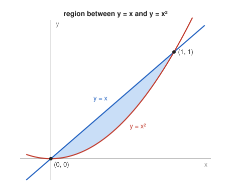

# Problem 4 — Area Between Curves

## The Problem

Find the area of the region bounded by the graphs

$$
y=x
$$

and

$$
y=x^2.
$$

First find the intersection points and justify which function is greater on the relevant interval.

---

## What Are We Looking For?

We want the area of the region enclosed by the line $y=x$ and the parabola $y=x^2$.

---

## Idea and Theorem Before the Calculation

**Area between curves:** If $g(x)\ge h(x)$ on $[a,b]$, the area between the graphs is

$$
\int_a^b\left(g(x)-h(x)\right)dx.
$$

The limits are the $x$-coordinates of the intersection points, and the upper function must be identified first.

---

## Step-by-Step Solution

**Step 1: Intersection points.**

$$
x=x^2\iff x^2-x=0\iff x(x-1)=0\iff x=0\ \mathrm{or}\ x=1.
$$

The points are $(0,0)$ and $(1,1)$.

**Step 2: Which function is greater.**

For $0<x<1$: $x-x^2=x(1-x)>0$, so the line lies above the parabola. For example at $x=\frac12$: $\frac12>\frac14$.

**Step 3: Area.**

$$
A=\int_0^1\left(x-x^2\right)dx=\left[\frac{x^2}{2}-\frac{x^3}{3}\right]_0^1=\frac12-\frac13=\frac16.
$$

---

## Sketch

---

## Final Answer in Words

The curves intersect at $(0,0)$ and $(1,1)$; on $[0,1]$ the line $y=x$ lies above the parabola $y=x^2$. The enclosed area is

$$
A=\int_0^1(x-x^2)\,dx=\frac16.
$$

---

## Quick Verification

The triangle under $y=x$ on $[0,1]$ has area $\frac12$, and the region under $y=x^2$ has area $\int_0^1x^2\,dx=\frac13$. The difference $\frac12-\frac13=\frac16$ is the same. The result is positive and smaller than the triangle, as it must be.

---

## Common Mistakes

- **Reversing the order:** $\int_0^1(x^2-x)\,dx=-\frac16$ is negative, a sign that the functions were swapped.
- **Using wrong limits:** the region lies between the intersection points $0$ and $1$.
- **Assuming $x^2>x$ because "the square is bigger":** on $(0,1)$ squaring makes numbers smaller.

---

## Oral Explanation (3 sentences)

The curves $y=x$ and $y=x^2$ meet where $x=x^2$, that is at $x=0$ and $x=1$. Between these points the line is above the parabola, because $x-x^2=x(1-x)>0$. The area is therefore $\int_0^1(x-x^2)\,dx=\frac12-\frac13=\frac16$.
