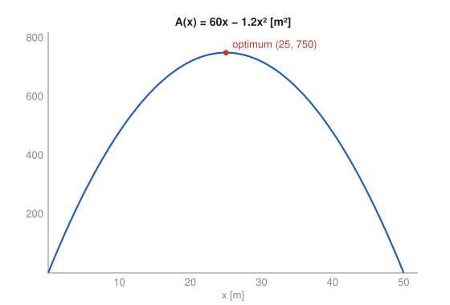

# Problem 12 — Complete Model and Computer Verification

## The Problem

A museum wants to create a rectangular exhibition room next to an existing straight wall. The side along the wall does not need to be built. The remaining three sides are to be constructed to two different standards: the two sides perpendicular to the wall cost $300\ \mathrm{PLN/m}$ each, while the side parallel to the wall costs $500\ \mathrm{PLN/m}$. The budget is $30\,000\ \mathrm{PLN}$.

Build a model that maximizes the area of the room and prepare a complete analysis containing:

- definition of variables and units,
- mathematical model,
- domain resulting from the problem statement,
- computation of the derivative,
- determination and verification of the optimum,
- interpretation of the result,
- graph of the objective function,
- numerical verification of several values near the optimum found.

Finally, indicate which part of the solution required modeling the problem and which part was only the execution of the calculation. Produce the graph and computer calculations only after completing the mathematical solution, and treat them as verification.

---

## What Are We Looking For?

We want the dimensions of the rectangular room that give the largest floor area for the given budget, with a full analysis and an independent computer check.

---

## Idea and Theorem Before the Calculation

**Optimization with a constraint:** the budget links the two side lengths, so one variable can be eliminated and the area becomes a function of one variable.

**Closed-interval reasoning:** a continuous function on an interval attains its maximum at a critical point or at an endpoint.

---

## Step-by-Step Solution

**Step 1: Variables and units.**

- $x$ [m]: length of each of the two sides perpendicular to the wall,
- $y$ [m]: length of the side parallel to the wall,
- $A$ [m²]: floor area of the room,
- costs in PLN.

**Step 2: Mathematical model.**

Cost of the three built sides:

$$
300x+300x+500y=600x+500y.
$$

The whole budget should be used (spending less cannot give a larger room, since increasing $y$ increases the area), so

$$
600x+500y=30\,000\quad\Longrightarrow\quad y=60-\frac{6}{5}x.
$$

Objective function:

$$
A(x)=x\,y=x\left(60-\frac65x\right)=60x-\frac65x^2.
$$

**Step 3: Domain.**

Both sides must be positive: $x>0$ and $60-\frac65x>0$, i.e. $x<50$. So

$$
0<x<50.
$$

At both ends the room degenerates and $A\to0$.

**Step 4: Derivative.**

$$
A'(x)=60-\frac{12}{5}x.
$$

**Step 5: Optimum.**

$$
A'(x)=0\iff x=25.
$$

Then

$$
y=60-\frac65\cdot25=30,\qquad A(25)=25\cdot30=750\ \mathrm{m}^2.
$$

**Verification of the maximum:** $A'(x)>0$ for $x<25$ and $A'(x)<0$ for $x>25$, and $A''(x)=-\frac{12}{5}<0$. Since $x=25$ is the only critical point in $(0,50)$ and $A\to0$ at the ends, it is the global maximum.

**Budget check:** $600\cdot25+500\cdot30=15\,000+15\,000=30\,000$ PLN.

---

## Interpretation

The best room is $30$ m along the wall and $25$ m deep, with area $750\ \mathrm{m}^2$. At the optimum the budget is split equally: $15\,000$ PLN for the two perpendicular sides and $15\,000$ PLN for the parallel side. This is not a coincidence: for $A=xy$ with a linear budget $px+qy=B$, the maximum always spends $\frac{B}{2}$ on each type of side. Because the parallel side is more expensive per meter, it is shorter than it would be with equal costs, but it is still longer than the perpendicular sides, since only one parallel side has to be built while there are two perpendicular sides.

---

## Graph of the Objective Function



The graph is a downward parabola with zeros at $0$ and $50$ and its vertex at $(25,750)$, symmetric about $x=25$.

---

## Numerical Verification

The following Python script, written after the analytical solution, evaluates the model near the optimum and searches a fine grid:

```python
def area(x):
    y = (30000 - 600 * x) / 500   # length of the side parallel to the wall
    return x * y

for x in [20, 24, 24.5, 24.9, 25, 25.1, 25.5, 26, 30]:
    y = (30000 - 600 * x) / 500
    cost = 2 * 300 * x + 500 * y
    print(f"x = {x:5.1f} m   y = {y:5.2f} m   A = {area(x):7.2f} m^2   cost = {cost:8.1f} PLN")

best = max((area(k / 1000), k / 1000) for k in range(1, 50000))
print("grid maximum:", best)
```

Output:

```
x =  20.0 m   y = 36.00 m   A =  720.00 m^2   cost =  30000.0 PLN
x =  24.0 m   y = 31.20 m   A =  748.80 m^2   cost =  30000.0 PLN
x =  24.5 m   y = 30.60 m   A =  749.70 m^2   cost =  30000.0 PLN
x =  24.9 m   y = 30.12 m   A =  749.99 m^2   cost =  30000.0 PLN
x =  25.0 m   y = 30.00 m   A =  750.00 m^2   cost =  30000.0 PLN
x =  25.1 m   y = 29.88 m   A =  749.99 m^2   cost =  30000.0 PLN
x =  25.5 m   y = 29.40 m   A =  749.70 m^2   cost =  30000.0 PLN
x =  26.0 m   y = 28.80 m   A =  748.80 m^2   cost =  30000.0 PLN
x =  30.0 m   y = 24.00 m   A =  720.00 m^2   cost =  30000.0 PLN
grid maximum: (750.0, 25.0)
```

Every tested room uses exactly the budget, the area values are symmetric around $x=25$ (as expected for a parabola), all are below $750$, and the grid search over $x\in(0,50)$ with step $0.001$ finds the maximum $750$ at $x=25$.

---

## Modeling Versus Calculation

**Modeling** (the part that required decisions): choosing the variables $x$ and $y$; noticing that only three sides are built and that there are two perpendicular sides but one parallel side; turning the prices into the budget equation $600x+500y=30\,000$; arguing that the whole budget should be spent; and deriving the domain $0<x<50$ from the requirement that the room is a genuine rectangle.

**Calculation** (routine execution): solving for $y$, differentiating $A(x)=60x-\frac65x^2$, solving $A'(x)=0$, checking the sign of $A'$, and evaluating $A(25)$. The graph and the script only verify these results.

---

## Final Answer in Words

With $x$ the depth of the room and $y$ its length along the wall, the budget gives $y=60-\frac65x$ and the area $A(x)=60x-\frac65x^2$ for $0<x<50$. The maximum is at $x=25$ m, $y=30$ m, with area $750\ \mathrm{m}^2$, and the budget is split equally between the two types of sides. The graph and the numerical table confirm this optimum.

---

## Quick Verification

Completing the square: $A(x)=750-\frac65(x-25)^2\le750$, with equality only at $x=25$. This confirms the maximum without derivatives and explains the symmetry seen in the table.

---

## Common Mistakes

- **Including the wall side in the cost:** the side along the wall is not built.
- **Using one perpendicular side instead of two:** the cost is $2\cdot300x$.
- **Assuming the optimum is a square:** unequal costs and the missing fourth side make it a $25\times30$ rectangle.

---

## Oral Explanation (3 sentences)

The budget equation $600x+500y=30\,000$ expresses the length along the wall as $y=60-\frac65x$, so the area becomes $A(x)=60x-\frac65x^2$ for $0<x<50$. Its derivative $60-\frac{12}{5}x$ vanishes at $x=25$, where the area reaches its maximum $750\ \mathrm{m}^2$ with $y=30$ m, using half the budget on each type of side. The graph and a short computer check of nearby values confirm that no other admissible room is larger.
